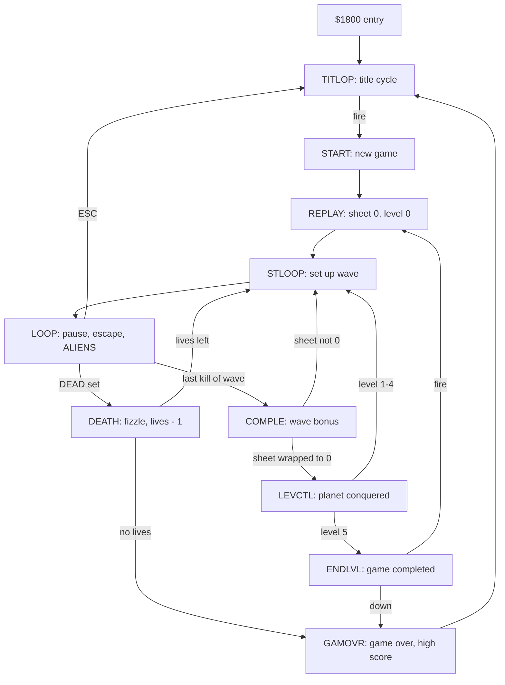

# Xargon's Revenge C16 – Codebase Analysis

## Purpose, Scope and Evidence

This analysis explains how the surviving Xargon's Revenge source works, so that someone can learn it, change it safely or carry it to another platform. It describes the reassembled source build, `build/xargons-revenge.prg`, whose code matches all 8,094 bytes of the original `OBJ` listing.

Four kinds of statement appear below, and they are kept apart:

| Label       | Meaning                                       |
| :---------- | :-------------------------------------------- |
| Instruction | Read directly from the assembled source       |
| Observed    | Seen in a VICE run or a recorded probe        |
| Inference   | Reasoned from code, not executed in isolation |
| Proposal    | A suggested change; nothing implements it     |

Where a paragraph rests on a probe it names the probe in [`docs/verification/rule-probes.json`](docs/verification/rule-probes.json). Source comments are quoted as evidence of intent, not as proof of behaviour; several comments are out of date, and those cases are pointed out.

The generated [code reference](docs/analysis/CODE_REFERENCE.md), [codebase index](docs/analysis/codebase-index.json) and [asset data](docs/analysis/asset-data.json) give every symbol address, module span and exported table. The [illustrated graphics](docs/GRAPHICS.md) chapter shows the decoded artwork.

---

## Game and Verified Baseline

Xargon's Revenge is a horizontally scrolling shooter for the Commodore 16 and Plus/4. The player's ship sits at the left of a 16-row play window between a scrolling cavern roof and ground, moves up and down, and fires a horizontal laser at waves of 16 aliens that drift and weave from the right. Fuel drains over time and with shooting, and is topped up by flying into fuel pods.

| Item             | Value                                    |
| :--------------- | :--------------------------------------- |
| Machine          | PAL C16, 16 KB (also Plus/4)             |
| PRG load address | `$0400` (no BASIC stub)                  |
| Entry            | `$1800` (`SEI`, stack to `$FE`, ROM out) |
| Code region      | `$1800–$379D`, 8,094 bytes               |
| Alien graphics   | `$0400–$07FF` (`ALDATA`, file `BJH`)     |
| Landscape bank   | `$1000–$17FF` (file `LANDSCAPE-2`)       |
| Font bank        | `$3800–$3FFF` (file `FRAK!`)             |
| Highest address  | `$3FFF`; nothing needs more than 16 KB   |

**Instruction:** the entry code at `$1800` disables interrupts, sets the stack pointer to `$FE`, writes `$FF3F` to bank the ROM out, primes the message pointer `MESL` with `MESST`, pre-scrolls the landscape 41 times through `LANDGO`, clears TED register `$FF12` bit 2 so character data comes from RAM, and jumps to `TITLOP`.

**Observed:** in VICE (PAL C16, 16 KB, sound off) the rebuild draws its title, enters gameplay after one scripted fire press and keeps running. After 256 main-loop passes with no input the ship had lost two lives to colliding aliens and the game continued (`docs/verification/vice-verification.json`).

---

## Repository and Source Organization

`REVENGE` is the root module. It includes `MAIN-VARS`, `VARS` and `EXTRA-MEMORY` before setting `*=$1800`, then 48 code and data modules, then the 16 `SHEET` modules: 67 `.LIB` lines in a fixed order. That order is preserved exactly, because tables and code that follow one another in memory sometimes depend on it.

### Module Responsibilities

| Module group                        | Responsibility                            |
| :---------------------------------- | :---------------------------------------- |
| `REVENGE`                           | Entry, include order, `SNDFLG`, `JOYSEL`  |
| `MAIN-VARS`, `VARS`                 | TED equates, zero-page state `$02–$FD`    |
| `EXTRA-MEMORY`                      | `ALICOL`, `STARSP`, `BIGBUF` at `$0200`   |
| `TITLE-LOOP`, `TITLE-WORK`          | Title cycle, banner scroll, fade          |
| `TITLE-GENERATE`, `BANNER-DATA`     | Random row order, 320-byte banner         |
| `ALTERABLES`                        | J/K and S/Q choices on the title line     |
| `PLAY-GAME`                         | `START`, `REPLAY`, `STLOOP`, main `LOOP`  |
| `SET-SHEET`, `SHTABLE`, `SHEET*`    | Per-wave colours, patterns, difficulty    |
| `INIT-SHEET`, `EXPLOSIONS`          | Alien glyph copy, generated explosions    |
| `ALIEN-CODE`, `ALI-PRINT&CLEAR`     | Alien movement, drawing, hits, scoring    |
| `MOVE-SHIP`, `SHIP-CALCS`           | Ship movement, glyph build, collision     |
| `SHIP-DEF`                          | Ship artwork (`SHPDT1`)                   |
| `FIRING-MEGA/CODE`                  | Laser start and movement                  |
| `FUEL-CODE`, `FUEL-CHAR/DATA`       | Fuel pods                                 |
| `FUEL-GAUGE`                        | Fuel drain, refill and gauge              |
| `SCORE-ROUTINES`, `HIGH-SCORE`      | BCD-style score, extra lives, high score  |
| `COMPLETED-SHEET`, `LEVEL-CODE`     | Wave end, fuel bonus, planets, completion |
| `DEATH-CODE`, `FIZZLE`              | Death sequence                            |
| `GAME-OVER`, `PAUSE/ESCAPE`         | Game over, pause, abort                   |
| `IRQ`, `RASTER-ROUTINES`            | Five-band raster interrupt chain          |
| `JOYSTIK`, `KEY-SCAN`               | Input                                     |
| `TOPLAND-PIXEL`, `BOTLAND-PIXEL`    | Roof and ground scrolling                 |
| `CHAR-ANIM`, `DATA-LAND/CHARS`      | Two animated landscape glyphs             |
| `TV-PICTURE`                        | Ship-height display in the ground scenery |
| `STAR-CODE`                         | 16-star parallax field                    |
| `MESSAGE-STUFF`, `WHOOPPEE-MESSAGE` | Bottom-row scrolling message              |
| `STARTER`                           | READY / STEADY / GO FOR IT                |
| `SOUND-EFFECTS`                     | Five effects on the two TED voices        |
| `RESET-CODE`                        | Reset trap screen                         |
| `UTILS`, `TABLES`, `PULSATE`        | Random numbers, delays, shared tables     |
| `LAND-GO`, `SCREEN-SETUP`           | Landscape pre-fill, HUD and window set-up |

Six of these modules exist only in the 1992 export and are used from there: `ALI-PRINT&CLEAR`, `COMPLETED-SHEET`, `DATA-LAND/CHARS`, `FIRING-MEGA/CODE`, `RASTER-ROUTINES` and `WHOOPPEE-MESSAGE`. [Source Inventory](docs/SOURCE_INVENTORY.md) records how they are selected.

---

## Runtime Architecture and Game States

Xargon's Revenge has no state variable that names the current mode. The mode is the code that is running, together with flags such as `TITLE`, `STOP`, `PAUSE`, `DEAD` and `KILLCO` that the raster interrupt reads.



### Title

**Instruction:** `TITLOP` clears zero page from `$12` upwards (`CLVARS`), sets `STOP`, `TITLE`, `MESSPD` and `STPSTR`, prints the top line, and installs the raster interrupt with `SETIRQ`. Each title cycle then picks a random sheet with `LDA TED / AND #15` for the landscape colours, clears the window with a random colour, scrolls the 16 banner rows on in random order (`REVTIT`), and waits 48 `DELAY` units. It fades the banner out cell by cell (`FADOFF`) and repeats.

Fire is tested at three places: `TITTER` in the wait loop, `BRING` while a row scrolls and `FAD4` during the fade. Each jumps to `READY` and `START`. While `TITLE` is set the interrupt calls `ALTER` every frame, which reads J, K, S and Q and redraws the top line.

### Game and Wave Set-up

**Instruction:** `START` clears zero page again, sets the ship to row 7, pixel 3, and sets `LIVES` to 5 and `FULINC` to 111. `REPLAY` zeroes `SHEET` and `LEVEL`. `STLOOP`, used at the start of every wave and after every death, calls `SETSHT`, `ALIDEF`, `SCREEN` and `PRSHIP`, clears `DEAD`, `ALIHIT` and `FUELTM`, and runs `STARTE`, which shows READY, STEADY and GO FOR IT on the first wave only (`STFLAG`).

**Observed:** at the first main-loop pass the rebuild has `TITLE=0`, `LIVES=5`, `SHEET=0` and `LEVEL=0`, and the running version has `LIVES=5` too. The cassette inlay and the *C16 Classics II* leaflet both say "3 lives". `PRLIVE` never draws more than three ship icons, which may explain the printed figure, but that is an inference.

### Main Loop

```text
LOOP:   CHKPAS  (SPACE pauses until G)
        CHKESC  (ESC returns to TITLOP)
        ALIENS  (waits for raster bit 8, then moves and draws 16 aliens)
        DEAD ? -> DEATH : LOOP
```

Everything else runs inside the raster interrupt: ship, stars, fuel pods, laser, scrolling, score display and sound.

---

## Memory Map and State Representation

| Range         | Contents                                      |
| :------------ | :-------------------------------------------- |
| `$0002–$009D` | Scalars in `VARS` (flags, pointers, counters) |
| `$009E–$00FD` | Alien and star tables, 16 bytes each          |
| `$0100–$01FF` | 6502 stack                                    |
| `$0200–$02BF` | `ALICOL`, `STARSP`, `BIGBUF` (160 bytes)      |
| `$0400–$07FF` | `ALDATA`: 16 aliens × 64 bytes                |
| `$0800–$0BE7` | TED colour (attribute) RAM                    |
| `$0C00–$0FE7` | Screen RAM, 40 × 25                           |
| `$1000–$17FF` | Landscape character bank (256 glyphs)         |
| `$1800–$379D` | Code, tables and text                         |
| `$379E–$37FF` | Unused                                        |
| `$3800–$3FFF` | Font and actor character bank (256 glyphs)    |

`EXTRA-MEMORY` describes `$0200–$07B8` as free, yet `MAIN-VARS` places `ALDATA` at `$0400`. The comment predates the move of the alien graphics; only `$0200–$02BF` is reserved by the source.

### Screen Geometry

The 40 × 25 matrix is split into bands. `SCRPOS` gives the 16 play-window rows, starting at `$0CA0` (row 4).

| Rows  | Screen RAM    | Role                          |
| :---- | :------------ | :---------------------------- |
| 0–1   | `$0C00–$0C4F` | Score, lives, fuel gauge      |
| 2–3   | `$0C50–$0C9F` | Cavern roof                   |
| 4–19  | `$0CA0–$0F1F` | Play window (window row 0–15) |
| 20–23 | `$0F20–$0FBF` | Ground                        |
| 24    | `$0FC0–$0FE7` | Scrolling message             |

Colour RAM is always screen address − `$0400`; nearly every drawing routine computes it by subtracting 4 from the high byte (`SCORPS-$400`, `SHPCOL`, `CL`, `COL`).

### Runtime-Modified Characters in the Font Bank

| Codes   | Address       | Written by                         |
| :------ | :------------ | :--------------------------------- |
| 63      | `$39F8`       | Laser glyph (`FIRE`, `LAZCLR`)     |
| 107     | `$3B58`       | Partial fuel-gauge cell (`UPFUEL`) |
| 124–135 | `$3BE0–$3C3F` | Ship, rebuilt for each pixel row   |
| 180–185 | `$3DA0–$3DCF` | Fuel pod, rebuilt each frame       |
| 213–220 | `$3EA8–$3EE7` | Current wave's alien, 2 frames     |
| 221–236 | `$3EE8–$3F67` | Generated explosions, 4 frames     |

The landscape bank changes too: `CHAR-ANIM` rewrites codes 87 and 91, and `TV-PICTURE` draws into codes 166–170.

---

## Interrupt Scheduling and Timing

`SETIRQ` points the RAM IRQ vector `$FFFE` at `SERV`, points the NMI and RESET vectors at `RESET`, enables the TED raster interrupt and clears `INTYPE`. Each interrupt advances `INTYPE` through 0–4, dispatches, and sets the raster line for the next band before `RTI`.

| `INTYPE` | Handler | Next line | Work done                                  |
| :------- | :------ | :-------- | :----------------------------------------- |
| 0        | `RAST1` | `$21`     | Roof scroll, bank `$1000`, colours, input  |
| 1        | `RAST2` | `$A2`     | Bank `$3800`, ship colours, most game work |
| 2        | `RAST3` | `$C1`     | Ground scroll, land colours, laser         |
| 3        | `RAST4` | `$CB`     | Message scroll, background `$32`           |
| 4        | `RAST5` | `$11`     | 40 columns, status colours, ship, stars    |

`RAST2` does most of the per-frame work: `TOPMVE`, `BOTMVE`, `TVPIC`, `REFRSH`, `LANANI`, and when `STOP` is clear `FUELDO`, `ADFUEL`, `UPFUEL` and `SCORPT`. When `TITLE` is set it calls `ALTER`, and it always calls `MESSVE`. `RAST5` runs `FULCOD` and `SHIP` when `STOP` is clear and `STARS` every frame.

**Instruction:** the dispatch is self-modifying. `SERV` computes `INTYPE × 3` and stores it into the operand of `BRAN: BNE BRAN`, which then branches into a table of five `JMP` instructions. For `INTYPE=0` the value is 0, the branch is not taken, and execution falls into `JMP RAST1`.

### Foreground Pace

`ALIENS` starts with `RUSRAS`, which waits for raster bit 8 (`$FF1C` bit 0) to go from 1 to 0 and back to 1. The main loop therefore runs at most once per frame, 50 times a second on PAL, and more slowly if a pass takes longer than a frame. Aliens step every `ALISPD` passes (5–8), so the alien speed in real time is tied to the PAL frame rate. **Inference:** an NTSC machine would run the IRQ work at 60 Hz and the aliens correspondingly faster.

---

## TED Display Model and Hardware Coupling

The game uses no hardware sprites (TED has none). Everything is character graphics in two 256-glyph banks, switched by the raster bands through `$FF13`.

**Instruction:** `RAST1` writes `$FF07` with bit 4 set (multicolour enabled for the whole screen) and bit 7 set (no hardware reverse). Each cell's attribute byte then decides:

| Attribute bit 3 | Pixel values                                 |
| :-------------- | :------------------------------------------- |
| 0 (hires)       | 0 → background, 1 → attribute & `$7F`        |
| 1 (multicolour) | 00 bg, 01 `$FF16`, 10 `$FF17`, 11 attr&`$77` |

Aliens and stars use hires attributes; the ship (`$2A`), fuel pod (`$68|n`), explosions (`$48|n`) and landscape (`LANCLn`) are multicolour. `$FF16` and `$FF17` are the ship colours `SHIPC1`/`SHIPC2` in the play window and the land colours `LANCL2`/`LANCL3` elsewhere.

The roof, ground and message bands use 38-column mode with fine X scroll from `TOPLX`, `BOTLX` and `MESSX`. When a fine scroll passes 8 pixels, the routine moves the band's screen cells one column left and feeds a new column in at column 39.

**Observed:** rebuilding play-window rows 5–18 from captured screen RAM, colour RAM, font RAM and the captured colour variables reproduces the VICE screenshot except for 140 of 34,048 pixels. Every difference is a star that moved one step, or the ship's `MULTI2` colour cycle, after the frame was drawn (`docs/analysis/graphics/graphics-manifest.json`).

---

## Input, Pause and Escape

### Joystick

**Instruction:** `REDJOS` runs in `RAST1` every frame unless `KILLCO` is set. With `JOYSEL=1` it writes `$FD` to `$FF08` and reads the latch. If nothing is pressed it tries `$FA` instead. It also patches the instruction at `XTRCDE` to `LSR A` for the first port or `NOP` for the second, because fire is on a different bit for each port. Up, down and fire are rotated into bit 7 of `JUP`, `JDOWN` and `JFIRE`, and `JMOVE` is non-zero when anything was pressed.

### Keyboard

`KEY` scans three matrix positions through `KEYIT`, which writes the row mask to `$FD30` and `$FF08` and tests a column bit. Matrix positions were checked against VICE 3.10's Plus/4 keymap (`gtk3_sym.vkm`), not by pressing keys.

| Use               | Row mask | Bit   | Key    |
| :---------------- | :------- | :---- | :----- |
| Up                | `$FD`    | `$20` | S      |
| Down              | `$FB`    | `$80` | X      |
| Fire              | `$FE`    | `$02` | Return |
| Joystick (title)  | `$EF`    | `$04` | J      |
| Keyboard (title)  | `$EF`    | `$20` | K      |
| Sound on (title)  | `$FD`    | `$20` | S      |
| Sound off (title) | `$7F`    | `$40` | Q      |
| Pause             | `$7F`    | `$10` | SPACE  |
| Resume            | `$F7`    | `$04` | G      |
| Abort             | `$BF`    | `$10` | ESC    |

The `KEY-SCAN` comment says A, Z and Return, and the `PAUSE/ESCAPE` comment says HELP. Both are out of date: the tables select S, X and Return, as the inlay says, and pause is SPACE. `SNDFLG` starts at 0 (sound off) and `JOYSEL` at 1 (joystick), as the title line shows. S is both "sound on" on the title and "up" in play.

### Pause and Escape

`CHKPAS` sets `PAUSE`, `STOP` and `STPSTR`, clears the movement flags, saves and silences `$FF11`, and shows a flashing PAUSE / G TO PLAY message until G is pressed. `CHKESC` returns carry set when ESC is held, and `LOOP` then jumps to `TITLOP`.

---

## Ship Movement, Rendering and Collision

**Instruction:** `SHIP` runs in `RAST5`. When `JMOVE` is clear it only redraws the ship. Otherwise it handles fire first, then erases the 12 cells, moves `YPIX` by 2 pixels per frame and carries into `SHIPY` (rows 0–13 of the window), and redraws.

`PRSHIP` clears the 96 bytes of chars 124–135, then copies the 16 rows of each of the four `SHPDT1` columns into those chars at offset `YPIX`. The screen always shows the same 3 × 4 block of codes; only the glyph bytes move. The ship is fixed at column 1.

`CHKSHP` reads the screen codes under the ship before it draws:

| Code under ship | Effect                            |
| :-------------- | :-------------------------------- |
| below 179       | None (stars, laser, text, blanks) |
| 179–185         | Fuel pod collected (`KILFUL=1`)   |
| 186–220         | Death (`DEAD=1`)                  |
| 221 and above   | None (explosions, box borders)    |

When `YPIX` is 0 or 6 it checks only the two rows the ship actually covers. The landscape is never tested; the ship's range of rows keeps it inside the play window, so the cavern walls are scenery, not obstacles. **Inference:** this is why a stationary ship survives the roof and ground but not the aliens.

---

## Laser

**Instruction:** `FIRE` refuses while a laser is active or the ship is dead. It starts sound effect 0, sets the laser row from `SHIPY + PINK[YPIX/2]`, sets `LAZX=4`, and programs one `$FF` row into glyph 63 at the pixel row given by `FLOYD`. Every second shot (`FULDWN`) costs one unit of fuel through `SHOTFL`. A new shot needs the fire button to change state (`OLDFIR`).

`MVELAZ`, in `RAST3`, erases the old cell, advances one column per frame and writes code 63 with colour `$61`, until column 39. `LAS` remembers the cell so that a hit can erase it.

Hits are detected by the aliens, not the laser: `PRTALI` sets `HITIT` if any of the four cells it is about to overwrite already holds code 63.

---

## Aliens

### Wave Set-up

`SETSHT` seeds `RND` from TED timer bytes, then reads the wave's 8-byte `SHTABL` entry: movement pattern pointer, three land colours (`LANCL2` also becomes `SHIPC1`) and background colour. The last two bytes of each entry are spare. It places 16 aliens at random columns 14–39 and rows 0–13, with a random starting pattern index 0–7 and a random colour (`$40` plus random luminance bits and hue 1–7).

| Value    | Rule                                    |
| :------- | :-------------------------------------- |
| `NUMALI` | `TOKILL[LEVEL] + SHEET/2`; 16 on wave 1 |
| `REGEN`  | `NUMALI − 16` replacements              |
| `ALISPD` | `8 − (SHEET>>2 & 3)`, so 8, 7, 6, 5     |
| `MPGVAL` | `MPGVIL[LEVEL]`: 28, 24, 20, 18, 16, 14 |

`TOKILL` is 24, 24, 32, 32, 48, 48 by level.

### Graphics Selection

`ALIDEF` takes `CONVTB[SHEET & 15]` (an identity table), multiplies by 64 and copies 64 bytes from `ALDATA` into chars 213–220: frame 0 in 213–216 and frame 1 in 217–220. It then calls `CALEXP`, which builds four explosion frames in chars 221–236 by repeatedly ANDing the alien glyphs with TED timer bytes. **Inference:** the explosion shapes therefore differ from run to run.

**Observed:** the `alien-characters-per-sheet` probe shows chars 213–220 are identical between the rebuild and the running version for sheets 0–3, and different for sheets 4–15. See [Comparison with the Running Version](docs/SOURCE_AND_VALIDATION.md#comparison-with-the-running-version).

### Movement and Drawing

`ALIENS` decrements `ALTEM`. On the pass where it reaches 0 (every `ALISPD` passes) `NOBBO=0` and every alien toggles its animation frame and advances one step through its pattern; on other passes `NOBBO=1` and aliens are only redrawn, which is what catches laser hits between steps.

Pattern bytes are direction bits: 1 up, 2 right, 4 down, 8 left, so 9 is up-left and 12 down-left. `$FF` ends a pattern, which then restarts. Left movement wraps from column 0 to 39; right stops at 39; up and down clamp to rows 0 and 14. An alien is 2 × 2 cells drawn with `YVAL1` offsets 0, 1, 40, 41. **Inference:** an alien at column 39 writes its right half into column 0 of the next row, which the 38-column mask hides.

### Hits, Explosions and Respawning

When `HITIT` is set, `ALIENS` plays effect 1, sets the status to `%10000111` (exploding, counting down from 7), stores a random drift direction from `STTDIR` in `ALICOL`, awards points and clears the laser. `UPEXPL` counts the explosion down; when it ends, `ALIHIT` increases. If `ALIHIT` equals `NUMALI` the wave is over (`JMP COMPLE`). Otherwise the alien is marked dead (`$FF`) and `NEWALI` respawns it at column 38 if `REGEN` allows, or leaves the slot empty.

**Instruction:** `NEWALI`'s "no more" path discards its own return address with `PLA PLA` and jumps back into the loop.

---

## Fuel and Fuel Pods

`FUEL` runs from 0 to 111. The gauge is 14 cells: code 106 for full cells, 107 for the partial end cell (programmed from `ENDBIT`) and 108 for empty, coloured red below 24, yellow below 72 and green above.

| Effect              | Rule                                         |
| :------------------ | :------------------------------------------- |
| Time drain          | −1 every `MPGVAL` frames while not refilling |
| Shooting            | −1 every second shot                         |
| Refill              | +1 per frame while `FULINC` > 0, cap 111     |
| Fuel pod            | `FULINC=16`, +250 points, effect 3           |
| Empty tank          | `DEAD=1`                                     |
| Low fuel (below 24) | Effect 2 and a flashing red ship ink         |

**Inference:** at level 0 a full tank lasts about 28 × 111 frames, roughly 62 seconds, without shooting.

`FULCOD` (in `RAST5`) starts a pod after `FUELTM` counts down (255 frames at the start of a wave, then 224–255) at column 38 and a random height. It moves left 4 pixels a frame and bounces vertically 3 pixels a frame between pixel rows 3 and 120 of the window. The pod is six chars, 180–185, whose glyphs are rebuilt every frame from `FUELDA` for the current sub-cell position.

---

## Waves, Levels and Completion

**Instruction:** `COMPLE` increments `SHEET`. When it reaches 16 it resets to 0 and increments `LEVEL`, capping it at 5. It sets `ATTAK = LEVEL × 16 + SHEET` and prints "ATTACK WAVE nn COMPLETED" by counting `ATTAK` in decimal. It then empties the fuel tank into the score at `BONTEN × 10 + BONUNT` points per unit (25, 35, 45, 50, 60, 75 by level), refills `FULINC` with the old fuel plus 32, and calls `LEVCTL` when `SHEET` is back to 0.

`LEVCTL` on levels 1–4 prints the planet conquered and the next one (`PLANNM`: MAGNUM, KAYLIH, NEBULA, NILBEG, XARGON), awards 5,000 points and a bonus life, and returns to the next wave. On level 5 it jumps to `ENDLVL`, which prints the "CONGRATULATIONS MEGA PERSON!" award screen and waits for fire (replay) or down (game over).

**Observed:** the `wave-completion` probes call `COMPLE` with controlled `SHEET` and `LEVEL`. Waves 1, 16 and 64 continue to the next wave; completing sheet 15 of level 4 (wave 80) reaches `ENDLVL` with "ATTACK WAVE 80 COMPLETED".

So the source finishes the game after **80 waves**, five planets of 16. The inlay and leaflet advertise "96 levels – 16 waves". The sixth entries of `TOKILL`, `MPGVIL`, `BONUNT` and `BONTEN`, and the `LEVEL` cap at 5, are never used by a wave that is played.

`REPLAY` does not reset `ATTAK`. **Inference:** after a completed game, the first wave of the replay scores at the wave-8+ rate until it is finished.

---

## Score, Extra Lives and High Score

`SCRBUF` holds eight decimal digits, most significant first. `SCORE` adds the accumulator to the units digit with carry; `SCORE+2` is an alternate entry that adds to the digit whose index is in Y: 7 is units, 4 thousands and 3 ten-thousands.

| Wave index (`ATTAK`) | Points per alien |
| :------------------- | :--------------- |
| 0                    | 50               |
| 1                    | 75               |
| 2                    | 100              |
| 3                    | 150              |
| 4                    | 200              |
| 5                    | 250              |
| 6                    | 300              |
| 7 and above          | 350              |

The inlay's "Aliens 50 points" is the first wave's value. The rates come from `ALSC1`–`ALSC3` and are read statically; no probe has fired at an alien.

**Observed:** the `score-*` probes confirm one extra life at 50,000, none on the next point, one at 100,000 and one at 150,000. The rule is: when the ten-thousands digit becomes 5 and `XTRA` is 0, add a life and set `XTRA=5`; when it becomes 0 with `XTRA=5`, add a life and clear `XTRA`. That is one life every 50,000 points, as advertised.

A bonus life also flashes the window background for 31 frames (`BONUS`, `MAGERS`). The high score lives as eight ASCII digits inside the title line text at `TPBUFF+32`. `HIGH` compares it with `SCRBUF` after a game, copies the score in if it is higher and shows "WELL DONE, YOU NOW HAVE THE HIGH-SCORE". It is never saved to disk or tape.

---

## Death, Game Over and the Reset Trap

**Instruction:** `DEATH` sets `STOP`, freezes the stars and scrolling, clears fuel, laser and sound, and runs `FIZZLE`, which saves the ship glyphs in `BIGBUF` and dissolves them over 64 frames with TED timer bytes before fading them out. It decrements `LIVES`. With lives left it refills the tank and restarts the same wave from `STLOOP`, with new alien positions and the kill count back at 0. With none left it clears the screen and runs `GAMOVR`, which shows GAME OVER in large letters, checks the high score, flashes for 192 frames and returns to the title.

`SETIRQ` points the RAM copies of both the NMI and RESET vectors at `RESET`, which shows " THAT WAS A VERY SILLY THING TO DO !!!! " and loops forever. The commented-out lines above it would have jumped to the ROM reset at `$F2A4` instead.

**Observed:** the `reset-during-play` probes reset VICE during play, both soft and hard. Both resumed at `$F2A4` in ROM, not at the trap, because a reset re-enables the ROM and its own vectors. Whether real hardware ever reaches the trap has not been tested.

---

## Landscape, Stars, Message and Title Effects

### Roof and Ground

`TOPMVE` and `BOTMVE` convert `TOPSPD`/`BOTSPD` (0–4; 1 means half speed) into a fine-scroll step. When a band moves a whole character, `HARTOP` shifts rows 2 and 3 and feeds a new column; every 4 columns `TOPNEW` picks one of 8 roof motifs, code base 192 + 8k. `HARBOT` does the same for rows 20–23; every 8 columns `BOTNEW` picks one of 6 ground motifs (`BOTST`: 0, 32, …, 160), never the same one twice running. The [landscape figure](docs/GRAPHICS.md#landscape) shows every motif.

`STARTE` and `COMPLE` change the scroll speeds from `SPDTOP`/`SPDBOT` to give the feeling of the ship accelerating and slowing.

### Animated Scenery

`LANANI` copies one of four 8-byte frames from `CHR87`/`CHR91` into landscape codes 87 and 91 every frame, cycling on `LANDAN` bits 2–3. `TVPIC` shifts a small picture inside landscape codes 166–170 and draws a bar whose height follows `SHIPY` through `HITTBL`, so a scenery "TV set" in the ground shows the ship's height.

### Stars

`INSTAR` sets 16 stars with X 0–158 in 2-pixel steps, a window row 0–15 and a speed 0–3. `STARS`, in `RAST5`, moves each star left by its speed plus 1 and draws one of codes 102–105 (the sub-cell position) in colour `STCOLS[speed]`, but only into a blank cell or another star. Stars that reach the left edge restart at the right with a new row and speed. `STSTOP` stops individual speed groups for the READY / STEADY / GO sequence.

### Message Scroller

`MESSVE` scrolls row 24 by `MESSPD` pixels a frame and feeds one character of `MESST` per cell. The message credits Micro Projects 1985 and advertises other Gremlin C16/Plus 4 games, including Xargon Wars, Petals of Doom, Tycoon Tex, Dork's Dilemma and Sword of Destiny.

### Title Banner

`BANNER` is 320 bytes, 20 per row for 16 rows; each nibble selects code 136+n, a 2 × 2 block glyph, and 0 means a space. `SCRLIT` scrolls each row in from a random side; `JOURNY+1`, the loop limit, is patched to 38 or 40 for the direction.

**Observed:** every captured title row equals a simulation of `SCRLIT`, apart from 7 star cells. Both directions leave the row one column right of the stored layout, repeating column 0 and losing stored column 39. **Instruction:** `COMPACTOR` packs `TITLE-DATA` into this format; applying its rule reproduces 318 of the 320 `BANNER` bytes (`banner_provenance` in the asset data).

---

## Sound

`SFX` starts an effect when `SNDFLG` is set. TED voice 1 plays the low-fuel warble; voice 2 plays everything else, so a new effect replaces the previous one on voice 2.

| Number | Effect         | Voice | Length and character               |
| :----- | :------------- | :---- | :--------------------------------- |
| 0      | Laser          | 2     | 16 frames, alternating noise/tone  |
| 1      | Alien hit      | 2     | 12 frames, random-pitch noise      |
| 2      | Low fuel       | 1     | Continuous rising/falling warble   |
| 3      | Fuel pod       | 2     | 24 frames, rising square wave      |
| 4      | Ship destroyed | 2     | 96 frames, noise with volume decay |

`REFRSH` services the effects once per frame in `RAST2`. The wave-completion bonus also writes voice 2 directly, with a pitch that falls with the fuel remaining. The `SOUND-EFFECTS` header calls it "an attempt to write a nice routine like our mate Robbie does". No sound has been listened to during this restoration.

---

## Graphics, Text and Palettes

| Asset           | Location               | Format                           |
| :-------------- | :--------------------- | :------------------------------- |
| Aliens          | `$0400`, `BJH`         | 16 × 64 bytes, hires 2 × 2       |
| Landscape       | `$1000`, `LANDSCAPE-2` | 256 multicolour glyphs           |
| Font and actors | `$3800`, `FRAK!`       | 256 glyphs, hires/multicolour    |
| Ship            | `SHPDT1`               | 4 columns × 16 rows, multicolour |
| Fuel pod        | `FUELDA`               | 3 columns × 8 rows, 2 phases     |
| Title banner    | `BANNER`               | 640 nibbles of block codes       |
| Big letters     | codes 152–175          | Double-width, two glyphs each    |
| Score digits    | codes 82–101           | Two-row digits                   |

Text in the code is screen codes via `AND #$3F`, so strings are stored as upper-case ASCII. "PRESS FIRE TO START", READY, STEADY and GO FOR IT are lists of letter indices (`PRSSTR`, `TESCO`) into double-width glyphs at codes 152–175. **Inference:** the `DOUBLE-WIDTH` utility made them; its letter list `PRESFITOA` is exactly the nine letters `PRSSTR` uses, although it writes to code 128 onwards rather than 152.

Colours are TED attribute bytes: low nibble hue, bits 4–6 luminance. [Illustrated Graphics](docs/GRAPHICS.md) decodes all of these with the palette measured from VICE.

---

## Original and Modern Development Tools

The source disk carries the 1985 toolchain alongside the game. None of it is used by the modern build.

| File               | Role (from its contents)                      |
| :----------------- | :-------------------------------------------- |
| `BOOT ALL`         | C64 BASIC: loads `DOS5.2` and `EDITOR64`      |
| `EDITOR64`         | "Commodore 64 Editor V072982", 1982 CBM       |
| `DOS5.2`           | "DOS V5.2 (C) Bugga-Soft 1984" disk wedge     |
| `ASM.C64`          | C64 assembler program                         |
| `MEGA-SUPER`       | C16 code at `$3C00` that loads `OBJ` hex      |
| `SUPER-LOAD`       | Earlier hex loader at `$1800`                 |
| `C16`              | C16 BASIC: programs F1 with the boot sequence |
| `LOADER`           | Loads `BJH`, copies it to `$0400`, runs game  |
| `DOUBLE-WIDTH`     | C64 BASIC: builds double-width title letters  |
| `DOUBLE-GENERATOR` | C16 BASIC: double-width letters and digits    |
| `COLOUR-SETTER`    | C16 BASIC: TED colour tester for `HILLS`      |
| `DESIGNER`         | C64 BASIC: screen designer (`XARG-SCREEN`)    |
| `BIG-PRINT`        | C64 BASIC: prints the title in large blocks   |
| `COMPACTOR`        | C64 BASIC: packs `TITLE-DATA` into the banner |

**Inference:** the source was edited and assembled on a C64 with the Commodore assembler, which writes the MOS hex `OBJ` file. That file was then loaded on the C16 by `MEGA-SUPER` through the F1 key macro in `C16`. The same set-up is described in the Dorks Dilemma [Development History](https://github.com/anthonyjclarke/Dorks_Dilemma_C16/blob/main/docs/DEVELOPMENT_HISTORY.md).

---

## Self-Modifying Code and Layout Dependencies

### Self-Modifying Instructions

| Site       | Patched by | Purpose                               |
| :--------- | :--------- | :------------------------------------ |
| `BRAN+1`   | `SERV`     | Branch offset into the IRQ jump table |
| `XTRCDE`   | `REDJOS`   | `LSR A` or `NOP` per joystick port    |
| `JOURNY+1` | `SCRLIT`   | Banner loop limit 38 or 40            |

`SNDFLG`, `JOYSEL`, `TPBUFF` (the title line and high score), `COMMES` and the `NOBBE1`/`NOBBE2` planet strings are writable data inside the code region. A ROM or flash port must move them to RAM.

### Calling Conventions and Alternate Entries

| Entry     | Contract                                      |
| :-------- | :-------------------------------------------- |
| `SCORE`   | A = amount added to the units digit           |
| `SCORE+2` | A = amount, Y = digit (7 = units)             |
| `BONLIF`  | Add a life and flash; no 50,000 test          |
| `DELAY+2` | X = outer count; `DELAY` itself uses X = 32   |
| `MVEALL`  | A = `NOBBO`; redraw aliens without stepping   |
| `SHOTFL`  | Fuel −1 and death test, without the tempo     |
| `KEYIT`   | A = column bit, Y = row mask; carry = pressed |
| `XY`      | X = column, Y = window row; sets `SCR`, `COL` |
| `STARXY`  | A = window row; sets `SL`                     |
| `NUM1T7`  | Returns 1–7 in A; preserves X                 |

### Shared State and Concurrency

The raster interrupt and the main loop share several routines and variables with no locking:

- `SCORE` and `SCRADD`: called from `ALIENS` (main) and `STPFUL` (interrupt).
- `RANDOM`, `RND` and `XTEMP`: used by `NUM1T7` in both contexts.
- `SFX` and the voice-2 registers: main for hits, interrupt for pods.
- `WORK` is main-loop scratch, but `COMPLE`, `LEVCTL` and `FIZZLE` use it while the interrupt runs; the interrupt uses `IRQWRK`.

**Inference:** a pod collected while the main loop is inside `SCORE` could corrupt the score. No case has been observed.

### Stack Discipline

`COMPLE` is reached by `JMP` from `UPEXPL`, two subroutine levels down, and leaves with `JMP STLOOP`. The fire tests in `BRING` and `FAD4` jump to `READY` from inside subroutines, and `ENDLVL` jumps out of `LEVCTL`. Each leaves return addresses on the stack, and only the entry at `$1800` resets the stack pointer. **Inference:** the 6502 stack pointer simply wraps within `$0100–$01FF`, so this does no harm unless something else is stored in page 1. A port should not model these transfers as nested calls.

### Table Adjacency and Code Contracts

- `JUP`, `JDOWN` and `JFIRE` are consecutive, because `KEY` writes them with `ROR JUP,X`.
- `SHPDT1` is four 16-byte columns read at +0, +16, +32 and +48; `FUELDA` is three 8-byte columns at +0, +8 and +16.
- The high-score digits are `TPBUFF+32` to `TPBUFF+39`, inside the title line.
- `SCRPOS` is shared by the aliens, stars, laser, fuel pod and banner.
- Screen-code ranges are contracts between modules: 63 laser, 102–105 stars, 179–185 fuel pod, 186–220 fatal, 213–220 aliens. Changing a glyph's code changes the collision rules.
- `CLVARS` clears `$12–$FF`, so variables below `$12` (`INTYPE` to `STPSTR`, including `MESL` and the scroll positions) survive a new game, and anything added above `$12` is cleared.

---

## Dormant and Unused Code

| Item                   | Evidence                                      |
| :--------------------- | :-------------------------------------------- |
| `PLANETS`, `BLOB-MOVE` | On disk, not included; undefined variables    |
| `CONVTB`               | Identity table                                |
| Sixth level entries    | Level 5 is never played                       |
| `LEVEL` cap at 5       | Unreachable after `ENDLVL`                    |
| `SHTABL` spare bytes   | Commented "UN-USED AT PRESENT"                |
| `.LIB ALIEN-DAT*`      | Commented out; data now in `ALDATA`           |
| `O.ALI`, `ALIBUM5–8`   | Earlier sets; `BJH` = first 1 KB of `ALIBUM8` |
| `BIGBUF` pause use     | Comment only; pause does not save lines       |

`PLANETS` and `BLOB-MOVE` would draw a drifting planet or meteor using star codes 148–152, which do not match the current star codes. **Inference:** they are left over from Xargon Wars or an abandoned idea.

---

## Code Statistics and How to Interpret Them

These come from `docs/analysis/codebase-index.json`.

| Measure                                  | Value |
| :--------------------------------------- | :---- |
| Source records available (SEQ, inc. hex) | 75    |
| Modules assembled into the main program  | 68    |
| Active modules including graphics source | 71    |
| Logical source lines in the main program | 7,291 |
| Instruction lines in the main program    | 2,815 |
| Symbols defined in the main program      | 682   |
| Direct symbolic transfers                | 515   |
| Self-modifying stores found statically   | 4     |
| Zero-page bytes reserved by `VARS`       | 252   |
| Bytes reserved at `$0200`                | 192   |
| Assembled main-region bytes              | 8,094 |

Logical lines include comments and blank `;` lines. Instruction lines count lines whose first word is a 6502 mnemonic, so data statements are excluded. The transfer count includes conditional branches and is a list of direct symbolic targets, not a call graph: it misses the self-modified IRQ dispatch, falls-through, returns and the `JMP`s out of subroutines described above. Module byte counts include embedded tables and text.

---

## Modification Map and Suggested Learning Sequence

### Where to Change Common Behaviour

| Change               | Routines and tables                       |
| :------------------- | :---------------------------------------- |
| Starting lives       | `START` (`LDA #5`)                        |
| Aliens per wave      | `TOKILL`, `SETSHT` (`BENORM`)             |
| Alien speed          | `SETSHT` (`ALISPD`)                       |
| Alien paths          | `PATD1`–`PATDG` in the `SHEET` modules    |
| Wave colours         | `SHTABL` equates in the `SHEET` modules   |
| Alien artwork        | `BJH` / `ALDATA`, `ALIDEF`                |
| Points per alien     | `ALSC1`–`ALSC3`                           |
| Extra-life threshold | `SCORE` (`CMP #5`, `XTRA`)                |
| Fuel drain           | `MPGVIL`, `FUELDO`, `SHOTFL`              |
| Pod value            | `STPFUL` (`FULINC`, score)                |
| Number of planets    | `LEVCTL` (`CMP #5`), `PLANNM`, `TIM6`     |
| Ship artwork         | `SHPDT1`, `PRSHIP`                        |
| Controls             | `BTD`, `RWD`, `ALTER`, `CHKPAS`, `CHKESC` |
| Message text         | `MESST` (ends with `$FF`)                 |
| Scroll speeds        | `SPDTOP`, `SPDBOT`, `TITLOP`              |

Any change here alters the bytes checked against `OBJ`. Make it in a separate variant, as the [Porting Guide](docs/PORTING_GUIDE.md#protect-the-preservation-build) describes.

### Reading and Debugging Sequence

1. Read `MAIN-VARS`, `VARS` and `EXTRA-MEMORY` with the memory map above.
2. Follow `REVENGE` into `TITLE-LOOP` and `PLAY-GAME`.
3. Read `IRQ` and `RASTER-ROUTINES` to see what runs in each band.
4. Read `SET-SHEET`, `INIT-SHEET` and `ALIEN-CODE` with one `SHEET` file.
5. Read `MOVE-SHIP`, `SHIP-CALCS` and `FIRING-MEGA/CODE`.
6. Finish with `COMPLETED-SHEET`, `LEVEL-CODE`, `SCORE-ROUTINES` and `DEATH-CODE`.

To watch it run, start VICE with `python3 scripts/run_vice.py`, open the monitor and use the labels in `build/revenge.labels` (`ll "build/revenge.labels"`). Useful breakpoints are `LOOP` ($2D63), `COMPLE` ($1BAC), `DEATH` ($212F), `ALIDEF` ($1D2C) and `SERV` ($2BB1). `scripts/probe_gameplay_rules.py` shows how to call a routine in isolation from a workspace caller at `$0BE8`.

---

## Verified Findings, Open Questions and Next Experiments

Verified:

- The code matches all 8,094 `OBJ` bytes, and the running version's code is the same.
- The running version's alien pages 1–3 are shifted by 1–3 bytes, changing sheets 5–16.
- Extra lives arrive every 50,000 points; the game ends after wave 80.
- Play starts with 5 lives in both versions.
- Resets in VICE go to the ROM, not the trap.
- Title and play-window graphics decode to the VICE pixels, except per-frame timing changes.

Open:

- Real-hardware behaviour of the reset trap, timing and sound.
- Whether the packaging's "3 lives" and "96 levels" reflect an earlier design or another release.
- Keyboard and joystick feel, alien scoring in play and a full play-through.

Next experiments: a probe that fires at an alien on wave 1 and wave 8 to confirm 50 and 350 points; a scripted run through a whole wave to `COMPLE`; and recording the sound.

---

## Regenerating the Developer Reference

```sh
python3 scripts/restore_c16.py
python3 scripts/verify_vice.py
python3 scripts/probe_gameplay_rules.py
python3 scripts/analyze_codebase.py
python3 scripts/render_game_graphics.py
```

`make docs` runs the build, analysis and handbook steps; the VICE and Pillow steps are separate. [Generated Developer References](docs/analysis/README.md) describes every output field.
