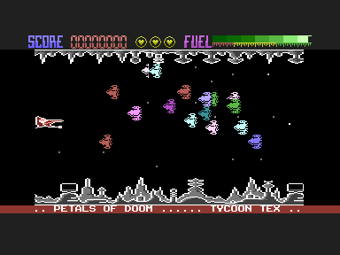
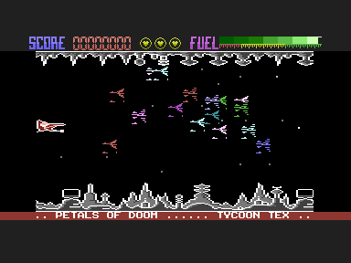

# Xargon's Revenge C16

This project reassembles the surviving **Xargon's Revenge** source for the Commodore 16 and Plus/4 using PlatformIO, VS Code and the cc65 toolchain. I wrote the game at Micro Projects as the sequel to my Xargon Wars, and Gremlin Graphics published it in 1985.

Open the [complete HTML handbook](docs/XARGONS_REVENGE.html) for the history, artwork, build guides, validation, code analysis, graphics and reference in one offline document. It's generated from the Markdown files, which stay the source of truth; [Maintaining the HTML Documentation](docs/HTML_DOCUMENTATION.md) explains how.


---

## Verified Build

The assembled code matches all **8,094 bytes in the original `OBJ` object listing**, with zero differences. Each PRG is 15,362 bytes, loads at `$0400`, where the alien graphics live, and starts at `$1800`. The landscape characters at `$1000` and the font at `$3800` are the binaries my own 1985 boot program loaded.

The build produces **two playable versions**, which differ only in their alien graphics:

| Version | File                           | Aliens on sheets 5–16              |
| :------ | :----------------------------- | :--------------------------------- |
| Game v1 | `build/xargons-revenge-v1.prg` | Twelve more designs, as drawn      |
| Game v2 | `build/xargons-revenge-v2.prg` | Sheet 1–4 designs, raised 1–3 rows |

Game v1 (development) is my source as my boot program loaded it. Game v2 (cassette release) is what the downloaded running version contains: the way its tape loader copies the alien graphics means sheets 5–16 reuse the first four designs. Once that copy decompresses in VICE, v2 matches it byte for byte in the aliens, code, landscape and font. [Game Versions](docs/GAME_VERSIONS.md) explains the difference with screenshots of both versions on every sheet, and [Source and Validation](docs/SOURCE_AND_VALIDATION.md) has the other comparisons and limits. [Other Versions](docs/OTHER_VERSIONS.md) compares six copies downloaded from Plus/4 World with both versions. A tape of the original 1985 cassette is game v2 byte for byte, the disk copies built from my development disks hold v1, and none has redrawn graphics. [Gremlin Archive and the Book](docs/GREMLIN_ARCHIVE.md) covers Mark Hardisty's archive of my development disks and his book *A Gremlin in the Works*.

In VICE, on a PAL C16 with 16 KB RAM, both versions draw their title, get into gameplay and keep playing.

 

 

---

## Build and Run

You need Python 3.9 or later and the cc65 tools (`ca65` and `ld65`), plus VICE (`xplus4`) to run the game. On macOS with Homebrew:

```bash
brew install cc65 vice
./build.sh
python3 scripts/run_vice.py --game-version 1
python3 scripts/run_vice.py --game-version 2
```

The outputs are `build/xargons-revenge-v1.prg` and `build/xargons-revenge-v2.prg`. The launcher loads the chosen version at its saved address once the C16 has reset and jumps to `$1800`; the PRGs have no BASIC `RUN` stub. `python3 scripts/run_vice.py --original` runs the compressed running version through its own `SYS 4109`.

With PlatformIO Core installed, or from the PlatformIO terminal in VS Code:

```bash
pio run -e c16
pio run -e c16 -t upload
pio run -e c16_v2 -t upload
```

Every environment writes both versions to `build/platformio/<environment>/`. The `c16` upload target launches game v1 in VICE and `c16_v2` launches game v2. The `c16_debug` environment produces identical game bytes, and every entry point runs the same `scripts/restore_c16.py` pipeline. [Quick Start](QUICKSTART.md) and [Build and Run](docs/BUILD_AND_RUN.md) have the details.

The keys are **S** up, **X** down and **Return** fire, or a joystick in either port; SPACE pauses, G resumes and ESC returns to the title. On the title page J and K choose joystick or keyboard, and S and Q turn sound on and off. That matches the cassette inlay. I still need to test the keys and a joystick by hand.

---

## Preserved Inputs

`Original Source Recovered/2026/` holds the two disk images I captured in 2026 and their extractions. `Xargon'sRevenge-C16.d64` is the source disk and the main build input. `XargonsRevenge-C16.d64` holds a loading screen and loader, which the build checks but doesn't use. `Original Source Recovered/1992/` holds my 1992 PC export of the source disk, both as the original ZIP and extracted. The six modules missing from the 2026 disk come from there, through its original `INDEX`.

`Original Artifacts/` has the cassette inlay, the cover painting, a second cover layout, a gameplay screenshot, a title picture, the *C16 Classics II* leaflet and a photo of the two development disks. The running PRG, `xargons_revenge.prg`, is in the project root. Everything generated goes into `build/`, and the original inputs stay byte for byte as they were.

[Source Inventory](docs/SOURCE_INVENTORY.md) lists every input and dependency, and the [Artifact Catalogue](docs/ARTIFACTS.md) describes the artwork.

---

## History and Recovery Background

I was always a fan of Scramble, so I wanted to write a scrolling game, and this became the sequel to Xargon Wars. The source header says it was "written by the Mega" (possibly a pseudonym for me; I'm not sure) and started "on a drizzly Saturday afternoon, 30 March". [History and Credits](docs/HISTORY_AND_CREDITS.md) separates what I remember from what the disks and packaging show.

The recovery story, my original development set-up and the recovery-tool acknowledgements are in my companion [Dorks Dilemma C16 repository](https://github.com/anthonyjclarke/Dorks_Dilemma_C16), especially its [Development History](https://github.com/anthonyjclarke/Dorks_Dilemma_C16/blob/main/docs/DEVELOPMENT_HISTORY.md). This project reuses that restoration's build approach, so I haven't repeated the story here.

---

## Learning, Modification and Ports

[Codebase Analysis](CODEBASE_ANALYSIS.md) walks through the game states, the five-band raster interrupt, the aliens, ship, laser, fuel, scoring, waves, sound, graphics and development tools, with a modification map and a reading order. Two findings differ from the packaging: the code finishes the game after 80 waves, not 96, and it starts you with 5 lives, not 3.

[Illustrated Graphics](docs/GRAPHICS.md) decodes the original artwork and checks it pixel by pixel against VICE. The [Porting Guide](docs/PORTING_GUIDE.md) keeps the original behaviour apart from the architecture I'd propose for new platforms. The [generated code reference](docs/analysis/CODE_REFERENCE.md), [asset data](docs/analysis/asset-data.json) and [codebase index](docs/analysis/codebase-index.json) help with finding your way around the source.

---

## Tests and Sharing

```bash
make test
make verify
make probes
make docs-check
```

The regression tests cover the PRG hash and header, every `OBJ` byte, source selection and fallbacks, graphics provenance, unchanged input hashes, syntax conversion and malformed inputs. The VICE test is reported as skipped when `xplus4` isn't installed. The VICE checks cover the title, gameplay entry, the running version and probes of scoring, alien graphics, wave completion and reset. I haven't yet tested the controls by hand, listened to the sound, finished a wave in play or played on real hardware. See [Testing](TESTING.md).

The repository is published on GitHub with a CI workflow; [Sharing on GitHub](docs/SHARING_ON_GITHUB.md) explains how. The historical notices are all kept; see [Rights and Preservation](RIGHTS.md). Releases are recorded in [`CHANGELOG.md`](CHANGELOG.md).
