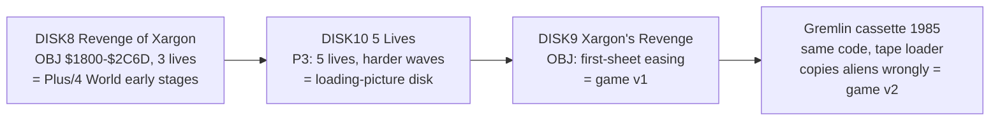

# Development Disks

## The Three Disks

On 22 October 2026 I copied my three original Xargon's Revenge development disks again, this time with both CBMXfer and OpenCBM `d64copy`. Each is in its own folder under `Original Source Recovered/2026 - 2nd Copy/`, with a photo of the disk and the matching 1992 PC export. `scripts/verify_second_copy.py` checks everything below and writes [`second-copy.json`](verification/second-copy.json). It reads the folder without changing it.

| Disk label                         | 1992 export | Disk name / ID          | 2026 read        |
| :--------------------------------- | :---------- | :---------------------- | :--------------- |
| Xargon's Revenge                   | `DISK9`     | `XARGON'S REVENGE` / MP | Clean, 100 files |
| Revenge of Xargon (Xargon Wars II) | `DISK8`     | `XARGON'S REVENGE` / MP | Clean, 82 files  |
| Xargon's Revenge – 5 Lives         | `DISK10`    | `XARGON GAMES` / 85     | 40 sectors lost  |

The 1992 names come from the `READ.ME` and `INDEX` files of my 1992 export, which Mark Hardisty publishes in the [Gremlin Graphics Archive](GREMLIN_ARCHIVE.md). Each 1992 folder matches the archive's copy, and `DISK9` is byte-identical to the copy this project already builds from.

/Disk%20Photo%20-%20Revenge%20of%20Xargon%20(Xargon%20Wars%20II).jpg)

The photos answer an old open question. In the [two-disk photo](ARTIFACTS.md#disks-and-leaflet), the disk in the Control Data sleeve, labelled "Revenge of Xargon (Xargon Wars II)", is `DISK8`. The Memorex disk labelled "Xargon's Revenge" is `DISK9`, the source disk. The third disk's label also names Xargon Wars: "C16/+4 $1000–$4000 start $1C80".

---

## What the Copying Tools Did

**The CBMXfer `.d64` files are empty.** All three are byte-identical: a blank formatted image named `TITLE`, ID `ID`, with no files. They are a failed export, not copies of the disks.

**CBMXfer also drops long file names.** Its folder exports for the two readable disks hold every file except those whose names are 15 or 16 characters long, or contain `/`. That leaves out `ALI-PRINT&CLEAR`, `COMPLETED-SHEET`, `DATA-LAND/CHARS`, `FIRING-MEGA/CODE`, `FUEL-CHAR/DATA`, `PAUSE/ESCAPE`, `RASTER-ROUTINES` and `WHOOPPEE-MESSAGE` (and `LAZER-DETECTION` on `DISK8`). Every file it did export is byte-identical to the `d64copy` sector copy.

**My first 2026 images were CBMXfer rebuilds.** Now in `Original Source Recovered/2026 - 1st Copy/`, the source disk image (`Xargon's Revenge.d64`) has the same blank header, `TITLE` / `ID`, and lacks exactly the six modules with 15- or 16-character names. That is why the build takes those six from the 1992 export ([Source Inventory](SOURCE_INVENTORY.md#active-assembly-sets)). The `d64copy` sector copy has them, and all six match the 1992 exports line for line. Its other 94 files are byte-identical to the first image. The first image is therefore complete and correct, just short of six files; the build output doesn't change.

**`d64copy` made true sector copies.** Its images keep the original disk name and ID and an error map: `1` for each good sector, `0` for unused sectors it skipped, and an error code for sectors it couldn't read.

---

## Xargon's Revenge (DISK9)

This is the source disk the project is built from. The sector copy holds all 100 files listed in the 1992 `INDEX`, plus two deleted entries, `SHOW DAD !` and `ALIBUM4`. Their sectors have since been reused (the chains run to 72 and 32 sectors where the directory says 4 and 9), so they can't be recovered.

Compared with the 1992 export, every source file matches as text and every binary byte for byte. The one apparent difference, in `CHAR#1-BOT`, is the PETSCII `¯` in a comment that the 1992 export turned into a space. The BASIC programs match once detokenized, apart from colour and cursor control codes inside strings, which the 1992 listing exporter dropped.

The 20 free sectors hold fragments of an older `OBJ` listing: 66 intact MOS hex records covering `$2D78–$37A2`. 63 of them match the code of the 5 Lives build (`DISK10`'s `P3`) at the same addresses. The other three hold the same movement-pattern tables (`PATDE`–`PATDG`) at the end of the code. So this disk once held the 5 Lives build's object listing, and the final `OBJ` was saved over it.

---

## Revenge of Xargon (DISK8)

This disk has the same disk name and ID as the source disk, `XARGON'S REVENGE` / MP, and is an earlier stage of the same game. The handwritten label calls it "Xargon Wars II". It holds 82 files: 27 are identical to the source disk, 44 differ, and 11 exist only here (`LAZER-DETECTION`, `INKEY`, `SETUP`, `SET#1`, `XARGII BOT LAND`, `Z II ROOF`, `ROOFY`, `CAMEL`, `SND`, `ENERGY CHRS`, `COMP-DATA`). Its `OBJ` covers `$1800–$2C6D`, 5,230 bytes against the final game's 8,094.

**It is Plus/4 World's "early stages" build.** That download's code is byte-identical to this disk's `OBJ`. Its font is this disk's `FRAK!` and its landscape is `LANDSCAPE-1`, both exactly. The rest of the file, after `$2C6D`, is only `$00` and `$FF` in blocks, an emulator's power-on memory saved along with the code.

**It starts with 3 lives.** `PLAY-GAME` here sets `LDA #3` / `STA LIVES`, where the source disk and the released game set 5. That explains the "3 lives" on the cassette inlay: the packaging text matches this earlier build. This disk has no `LEVEL-CODE` or `COMPLETED-SHEET` yet, so it has no planet progression, and the inlay's "96 levels" remains unexplained.

**A 1992 transfer slip.** In the 1992 export of this disk, `LANDSCA2.BIN` has the same bytes as `LANDSCA1.BIN`. The 2026 sector copy has the real `LANDSCAPE-2`, identical to the source disk's, with a clean chain. The 1992 transfer must have copied `LANDSCAPE-1` twice.

The free sectors hold 246 intact MOS hex records (`$1F60–$37FF`) that match none of the Xargon builds, even at shifted addresses. They are probably from another program and aren't analysed further.

---

## Xargon's Revenge – 5 Lives (DISK10)

This disk is decaying. Two `d64copy` reads agree that 40 allocated sectors can't be read; the CBMXfer attempt produced nothing. `verify_second_copy.py` merges the two reads, taking each sector from a read that reported it good, into `build/second-copy/five-lives-merged.d64` for analysis. The originals are untouched.

The directory is intact and matches the 1992 `INDEX` entry for entry:

| File               | Blocks | Verified against 1992 | Unreadable | Decayed |
| :----------------- | :----- | :-------------------- | :--------- | :------ |
| `LOADER`           | 1      | 1                     | 0          | 0       |
| `P1/$0C00-$1000`   | 5      | 5                     | 0          | 0       |
| `P2/$0800-$0C00`   | 5      | 4                     | 1          | 0       |
| `P3/$1000-$4000`   | 49     | 39                    | 8          | 2       |
| `P4/$0400-$0800`   | 5      | 4                     | 1          | 0       |
| `S3`               | 186    | 160                   | 19         | 6       |
| `XARGON WARS-1C80` | 49     | 38                    | 6          | 0       |

Every readable sector matches the 1992 `DISK10` export, apart from nine decayed sectors: the eight in the table and one more in `S3` that can't be placed by its links. Each starts correctly and turns to noise part-way through, even though the drive reported it as good; two of them read correctly on the other attempt. Nothing on the disk differs from the 1992 copy in a way that looks like different content, so `DISK10` stands in for the lost sectors.

`LOADER`, `P1` to `P4` are the disk distribution of the game: `LOADER` loads `P1` (screen) and `P2` (colour), the "written by Micro Projects" loading screen, then `P3` (the game) and `P4` (the aliens, byte-identical to `BJH`), and copies the aliens correctly. They are byte-identical to Plus/4 World's "with loading screen" download ([Other Versions](OTHER_VERSIONS.md#loading-picture-disk)). `XARGON WARS-1C80` is Xargon Wars, matching the label. `S3` is a `$0800–$BFFF` memory image that shares no code with any Xargon's Revenge build.

**My first 2026 copy of this disk** (`2026 - 1st Copy/Xargons Revenge - 5 Lives/Xargons Revenge - 5 Lives (partial).d64`) holds `LOADER`, `P1` and `P2` only, byte-identical to this disk's. They are the first three files in this disk's directory, and the next file, `P3`, has unreadable sectors, so that CBMXfer copy stopped there. All three disks are single-sided; the first copies were originally named "Side 1" (this disk) and "Side 2" (the source disk) only to tell the two working disks apart.

---

## How the Builds Fit Together

The order rests on evidence, not memory:

- **`DISK8` comes first.** It has 3 lives, no planet progression and much less code. The later disks hold the same modules, changed, plus the level and planet code it lacks.
- **`DISK10` before `DISK9`.** The source disk's free sectors still hold the 5 Lives build's object listing, which the final `OBJ` replaced. The 5 Lives build has 5 lives but demands more aliens per wave (32–72 against 24–48) and lacks the "first sheet: only 16 aliens" case in `SET-SHEET`.
- **`DISK9` is the release code.** The original 1985 cassette's code is byte-identical to its `OBJ`. Only the cassette's loader differs from my development loaders: it copies the aliens wrongly, which makes game v2.

None of the development disks holds the cassette loader or its source, so where the copy slip was made still isn't known.

---

## Still Open

- Where "96 levels" on the inlay comes from. No build I have has 6 planets of 16 waves.
- Whether another read of the 5 Lives disk, on a different drive or after cleaning, recovers more sectors. The 1992 export already covers them.
