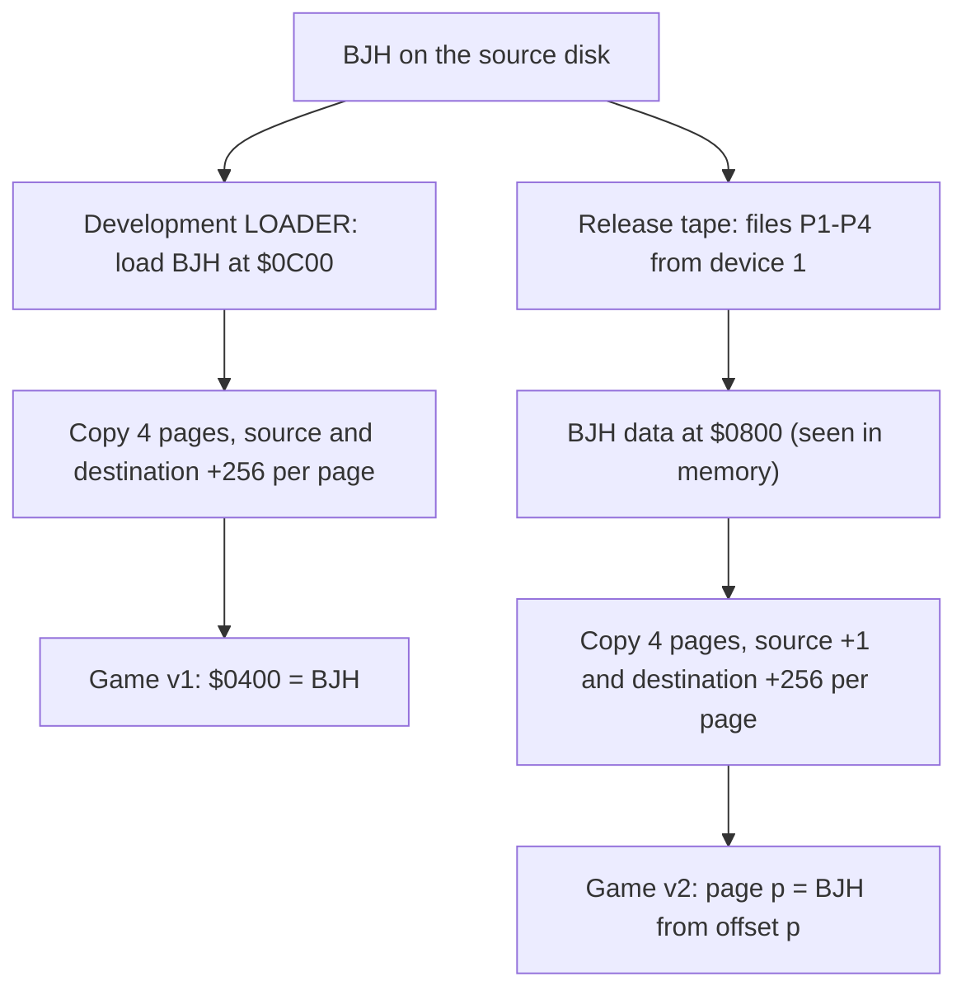
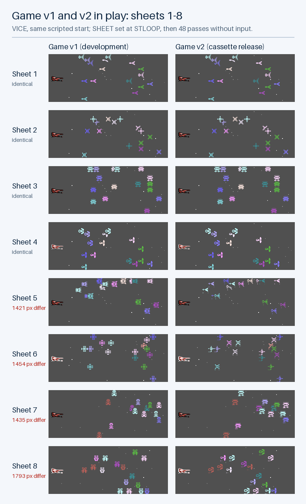
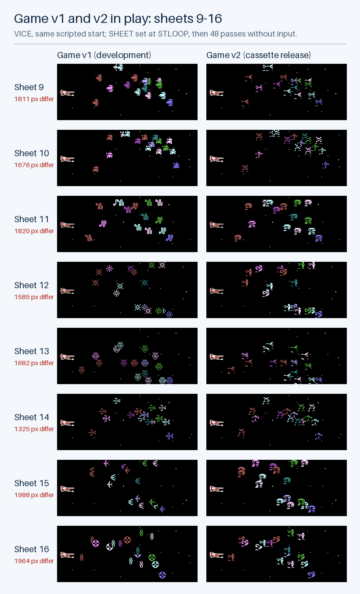
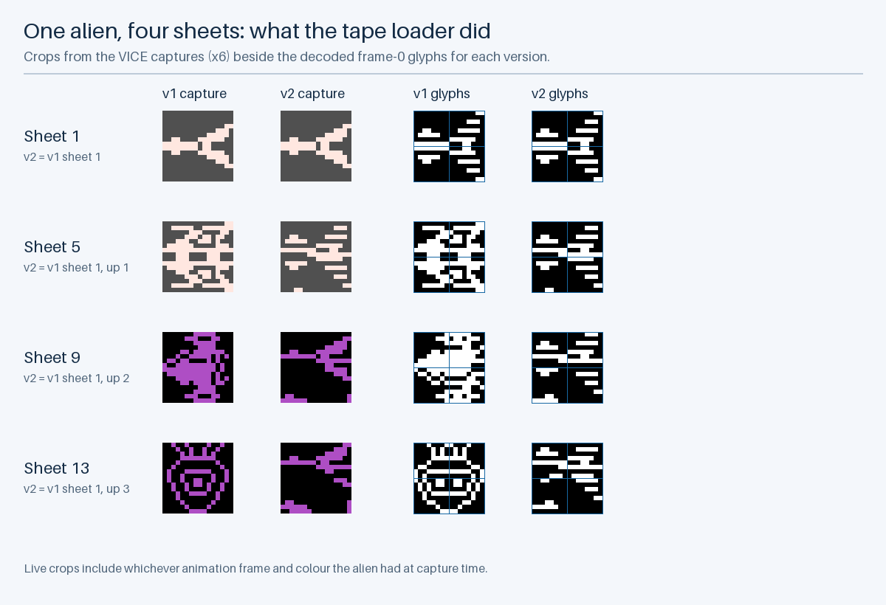

# Game Versions: v1 and v2

## Two Playable Versions

This project builds two playable versions of Xargon's Revenge from the same preserved source. They share every byte of code, the landscape and the font. They differ only in the alien graphics at `$0400–$07FF`.

| Version | Name             | File                           |
| :------ | :--------------- | :----------------------------- |
| Game v1 | Development      | `build/xargons-revenge-v1.prg` |
| Game v2 | Cassette release | `build/xargons-revenge-v2.prg` |

| Version | SHA-256 (start…end) | Alien graphics                      |
| :------ | :------------------ | :---------------------------------- |
| Game v1 | `32c13c88…adce33`   | `BJH` as stored: 16 designs         |
| Game v2 | `0ee0a823…397665`   | `BJH` by the tape loader: 4 designs |

Game v1 is what my own development boot program produced. Game v2 is what the downloaded running version, `xargons_revenge.prg`, contains: once it decompresses in VICE, v2 matches it byte for byte in the aliens, landscape, code and font. Both are assembled from preserved source; neither copies a byte from the download.

"Game v1" and "game v2" name these two versions of the game. They aren't the repository's release tags (`v1.0.0`, `v1.1.0`, `v1.2.0`).

```bash
python3 scripts/run_vice.py --game-version 1
```

```bash
python3 scripts/run_vice.py --game-version 2
```

`make run` and `make run-v2` do the same after building; `pio run -e c16 -t upload` runs v1 and `pio run -e c16_v2 -t upload` runs v2.

---

## Where the Difference Comes From

The alien graphics live in the file `BJH`, 1,024 bytes: sixteen 64-byte aliens, one for each sheet of a level. The game expects them at `$0400`. Both versions use the same `BJH`; what differs is how a loader copied it into place.



**Development loader.** `LOADER` on the source disk loads `BJH` at `$0C00`, copies four pages to `$0400` and jumps to `$1800`. My `C16` boot program runs it after loading the code, font and landscape. Its copy is correct.

**Release tape loader.** The downloaded copy still has another loader in memory at `$0C00` when the game starts. It reads files `P1`, `P2`, … from device 1, the cassette, until the name reaches `P5`; then it copies four pages from `$0800` to `$0400` and jumps to `$1800`. [`release-tape-loader.s`](verification/release-tape-loader.s) is a disassembly of those bytes, made only as evidence. The copy loop is:

```text
L0C31:  LDX #$00
L0C33:  LDA $0800,X     ; operand bytes at $0C34 (low) and $0C35 (high)
        STA $0400,X     ; operand bytes at $0C37 (low) and $0C38 (high)
        INX
        BNE L0C33
        INC $0C34       ; raises the LOW byte of the source address
        INC $0C38       ; raises the HIGH byte of the destination address
        DEY
        BPL L0C31
```

After one page the source is `$0801` instead of `$0900`, while the destination correctly moves to `$0500`. So page *p* of the aliens gets the 256 bytes that start at `BJH` offset *p*. The operands left in memory, `LDA $0804,X` and `STA $0800,X`, show exactly that end state. `scripts/verify_vice.py` checks them in [`vice-verification.json`](verification/vice-verification.json).

The loading-screen disk (`XargonsRevenge-C16.d64`) holds a loader with the same structure for device 8, files `P1*` to `P4*`. Its loop increments both high bytes, so it would copy correctly. No source for either the disk or the tape loader has survived.

---

## What the Players Saw

Because each page of v2 starts only 1 byte further into `BJH`, all four pages come from the first 259 bytes, which hold the aliens for sheets 1–4.

| Sheets | Page | Game v1 shows | Game v2 shows              |
| :----- | :--- | :------------ | :------------------------- |
| 1–4    | 0    | Designs 1–4   | Designs 1–4 (same)         |
| 5–8    | 1    | Designs 5–8   | Designs 1–4, raised 1 row  |
| 9–12   | 2    | Designs 9–12  | Designs 1–4, raised 2 rows |
| 13–16  | 3    | Designs 13–16 | Designs 1–4, raised 3 rows |

"Raised" means each glyph's rows move up, and the rows that appear at the bottom come from the next character in the alien. Twelve of the sixteen alien designs I drew never appear in v2.





These are VICE screenshots of the two PRGs. Each run starts the same way (one scripted fire press at the title), stops at `STLOOP`, sets `SHEET` to the wanted wave so the game's own `SETSHT` and `ALIDEF` set it up, and then runs 48 main-loop passes without input. Only `JFIRE` and `SHEET` are written; no instruction is changed.

The two versions make identical moves: in every pair the aliens have the same positions and animation states, recorded in [`game-versions.json`](verification/game-versions.json), and the screenshots show the same colours. Only the shapes differ. Sheets 1–4 are pixel-identical, and sheets 5–16 differ in 1,325 to 1,988 pixels.



The detail follows one design. In v1 sheets 1, 5, 9 and 13 have four different aliens; in v2 they are all the sheet 1 arrow, raised 0, 1, 2 and 3 rows. The left pair are crops of the live captures and the right pair the decoded glyphs.

Full screenshots of every sheet in both versions are in `docs/images/versions/`, for example sheet 9 in [v1](images/versions/v1-sheet09.png) and [v2](images/versions/v2-sheet09.png). [Illustrated Graphics](GRAPHICS.md#aliens) shows all 16 decoded aliens of each version side by side.

---

## What Is the Same

| Behaviour            | Game v1 and v2            |
| :------------------- | :------------------------ |
| Code `$1800–$379D`   | Identical; matches `OBJ`  |
| Landscape and font   | Identical                 |
| Starting lives       | 5 (observed in both)      |
| Game length          | 80 waves (from the code)  |
| Extra lives, scoring | Identical code            |
| Collisions           | By screen code, not shape |

Collisions are decided by character codes, not by pixels, so the different shapes don't change how the game plays. The packaging's "3 lives" and "96 levels" don't match either version.

---

## Which Version Is Right?

The evidence shows:

- v1 is what my source and my own boot program produced.
- v2 is what the downloaded running version contains, and that copy carries a cassette loader, so v2 is most likely the released cassette game. I haven't seen an original cassette to confirm it.
- The difference comes from one `INC` operand in that loader. It looks like a typing slip rather than a deliberate change: the rest of the game is identical, and the source has sixteen designs that v2 never shows.

As I recorded on 21 October 2026, I have no recollection of why there might be two versions. Maybe Gremlin Graphics, who published the game, gave us some feedback and wanted a different version. That is my speculation, not evidence; nothing in the source or on the disks shows a second build.

Game v1 stays the default because it is the source as written. Game v2 is preserved because it is what people actually played, if the downloaded copy is the release.

---

## Open Questions

- Which development disk label goes with which 2026 disk image. I need to plug the hardware in and check.
- Whether an original cassette shows the v2 aliens, which would confirm v2 as the release.
- Why the packaging says 3 lives and 96 levels.
