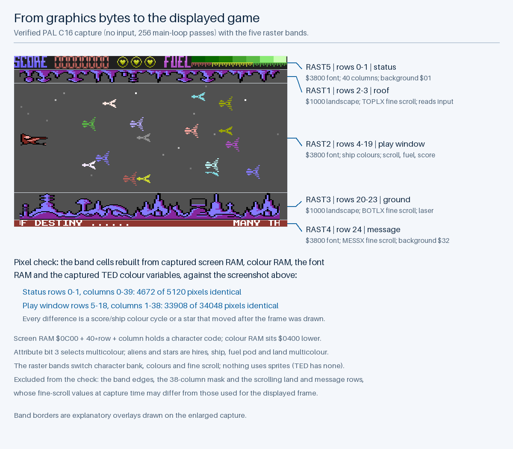
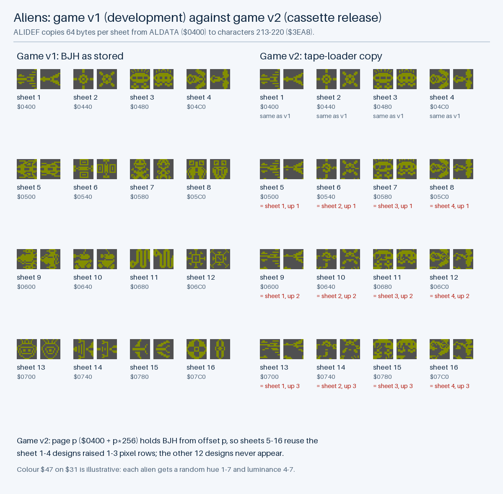
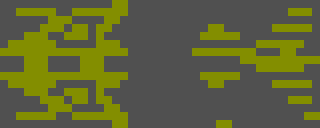
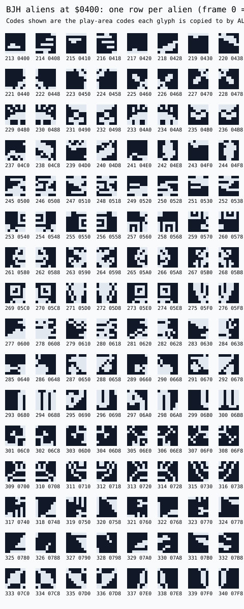
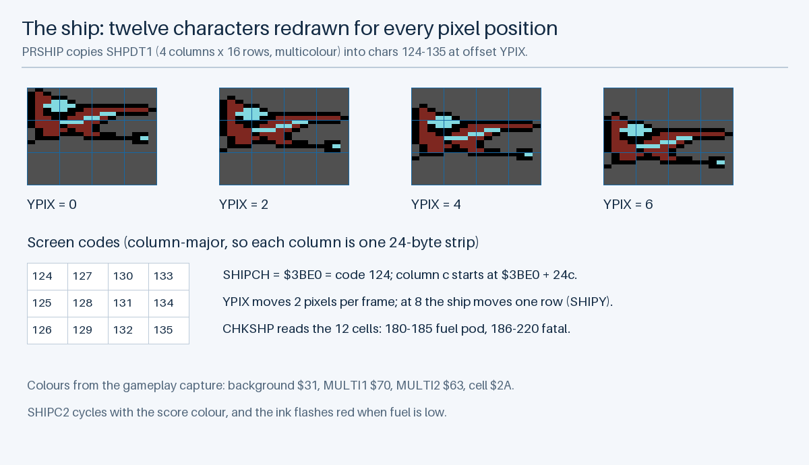
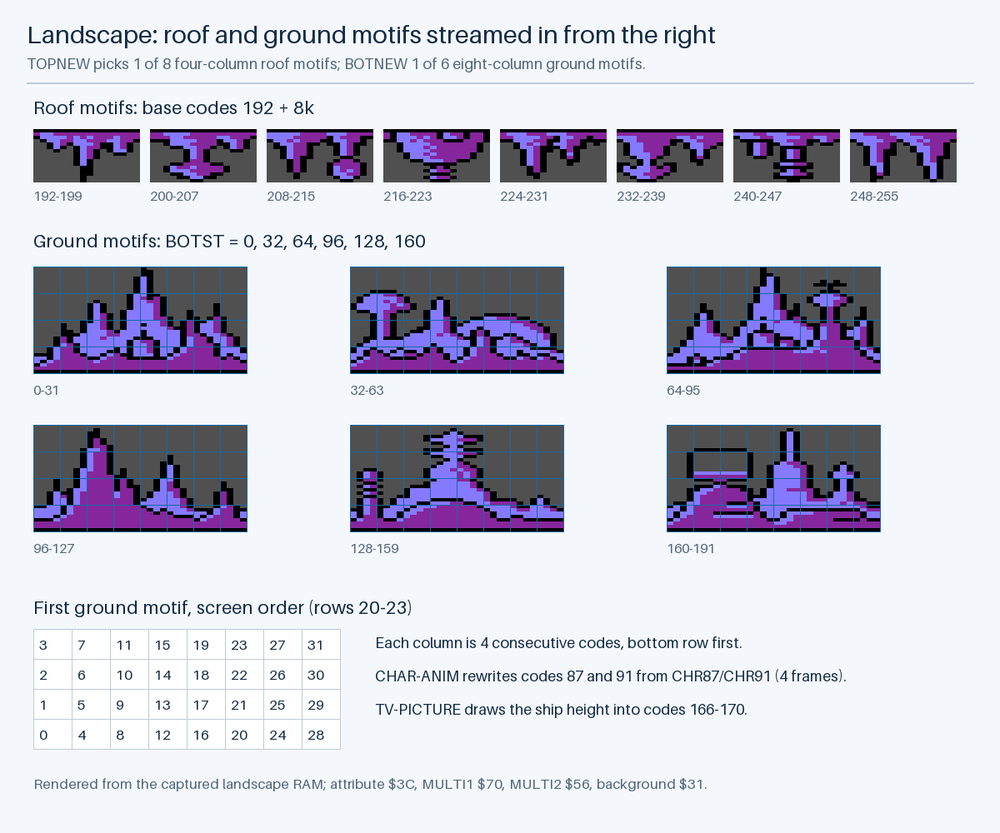
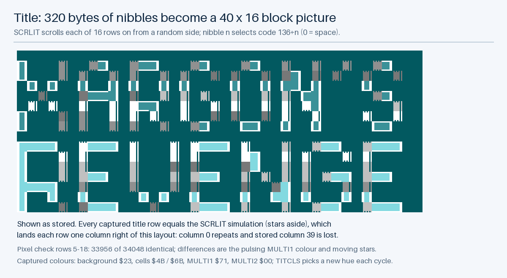
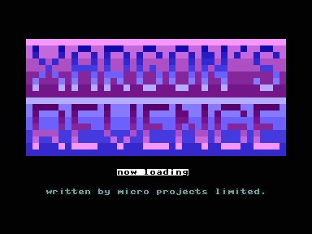

# Illustrated Graphics

## How These Figures Were Made

Every figure in this chapter is generated by `scripts/render_game_graphics.py` from the original bytes exported in [`asset-data.json`](analysis/asset-data.json). Nothing is redrawn by hand or by an image model. Pixels are enlarged with nearest-neighbour scaling, and grids, codes and captions are overlays.

Colours come from [`ted-palette.json`](verification/ted-palette.json), which I measured from VICE 3.10 by filling 128 screen cells with every TED colour index and reading back the unfiltered screenshot. All 31 colours in the gameplay screenshot appear in that palette. Where the game picks a colour at random, the caption says the colour shown is illustrative.

Input and output hashes are in [`graphics-manifest.json`](analysis/graphics/graphics-manifest.json). To regenerate, run `python3 scripts/render_game_graphics.py` with Pillow 10.1 or later.

---

## The Screen

The capture is the rebuild in VICE after 256 main-loop passes with no input. The game draws everything with characters in two 256-glyph banks, and the raster interrupt switches bank, colours and fine scroll for each band.

To check the decoding, the script rebuilds the status rows and play-window rows 5–18 from the screen RAM, colour RAM, font RAM and colour variables saved at the moment of the capture, and compares them pixel by pixel with the screenshot. 33,908 of 34,048 play-window pixels and 4,672 of 5,120 status pixels are identical. Each difference is something the game changes every frame after drawing it: a star that moved one step, the ship's second multicolour, or the score colour. The script fails if it finds a difference it can't explain.

---

## Aliens

`ALIDEF` copies one 64-byte entry from `ALDATA` (`$0400`) into codes 213–220 at the start of every wave: frame 0 into 213–216 and frame 1 into 217–220, drawn as a 2 × 2 block. The left half shows game v1: the source graphics, `BJH`, as my development loader placed them.

The right half shows game v2, the cassette release found in the running version I have. Its tape loader copies page *p* of the alien data from `BJH` offset *p* instead of *p* × 256, so every page comes from the first 259 bytes. Sheets 5–16 reuse the sheet 1–4 designs, raised one, two or three pixel rows with rows wrapped in from the next character, and twelve designs never appear. This is the only graphics difference between the two versions; [Game Versions](GAME_VERSIONS.md) shows both in play on every sheet.

The animation alternates the two frames of the alien for sheet 5: its own design in v1, and the sheet 1 arrow raised one row in v2. Its 250 ms frame time is for illustration; in the game an alien changes frame each time it steps, every 5–8 main-loop passes.

The atlas below shows all 128 source glyphs with their addresses, one alien per row, labelled with the play-area code each is copied to. Its colours are neutral index keys.

---

## The Ship

The ship never moves on screen while it climbs or dives within a row. `PRSHIP` rewrites the twelve glyphs 124–135 with the `SHPDT1` artwork shifted down by `YPIX` pixels, and only when the offset passes 8 does the 3 × 4 block of codes move a row. The ship is multicolour, with its two shared colours taken from the wave's land colour and the cycling score colour.

---

## Landscape

The roof uses eight four-column motifs starting at code 192, and the ground six eight-column motifs starting at codes 0, 32, 64, 96, 128 and 160. Each new column enters at the right edge as the band scrolls. Codes 87 and 91 are animated from `CHR87` and `CHR91`, and codes 166–170 hold the little picture that shows the ship's height.

These are rendered from the landscape RAM captured during play, so the animated codes show one of their frames. The complete bank is in the [landscape atlas](analysis/landscape-multicolor.svg), with neutral index colours.

---

## Title Banner

The title lettering is 320 bytes of nibbles. Each nibble picks one of 16 block characters, 136–151, so each character cell is a 2 × 2 pattern of quarter blocks. `SCRLIT` scrolls each row on from a random side.

Comparing with the captured title screen shows that every row lands one column to the right of the stored layout, repeating the first column and losing the last. A simulation of `SCRLIT` reproduces every captured row exactly, apart from seven cells where a star was passing.

The banner bytes came from my `COMPACTOR` utility, which packs the `TITLE-DATA` file two nibbles to a byte. Applying its rule to `TITLE-DATA` gives 318 of the 320 bytes; the other two differ, so the banner was edited after that file was saved.

---

## Font Bank

The [1-bit view](analysis/font-hires.svg) and [2-bit view](analysis/font-multicolor.svg) of `FRAK!` show all 256 glyphs at `$3800`. Some ranges are replaced while the game runs, as listed in [Codebase Analysis](../CODEBASE_ANALYSIS.md#runtime-modified-characters-in-the-font-bank), so the atlas shows their initial contents.

---

## Loading Screen

The first, partial 2026 copy of my 5 Lives disk holds a loading screen, files `P1` (screen) and `P2` (colour), plus a loader that expects `P1` to `P4`. This is how the C16 shows those two files, captured in VICE from the preserved bytes. "now loading" flashes; [this capture](images/loading-screen-flash.png) is the other phase. I don't remember it being used, and the image doesn't hold the rest of the game. Its files are the first three on my 5 Lives development disk, where the loader goes on to load the game (`P3`) and the aliens (`P4`) ([Development Disks](DEVELOPMENT_DISKS.md#xargons-revenge--5-lives-disk10)).
