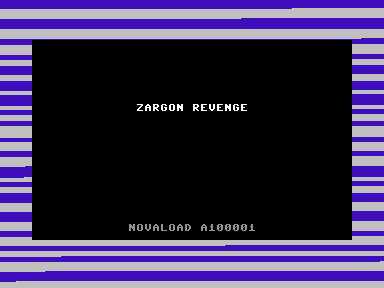
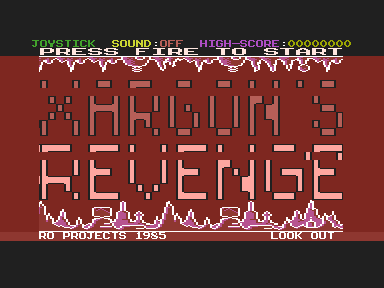
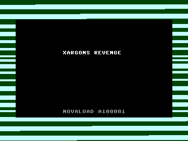
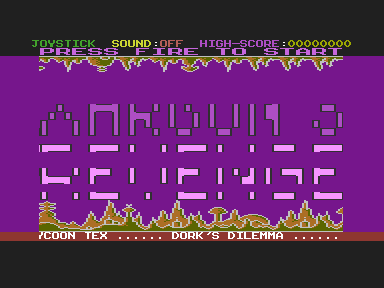
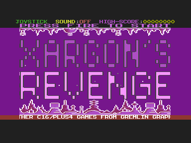
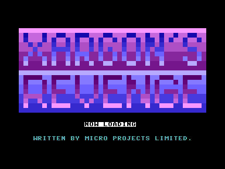
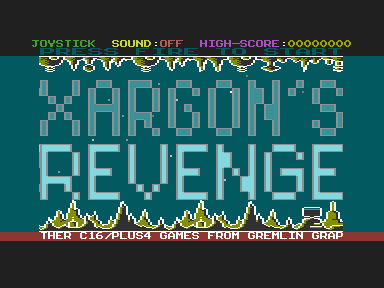
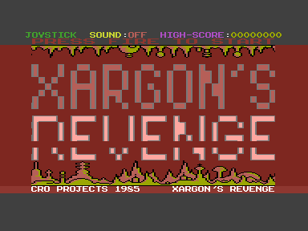

# Other Versions

## What I Compared

On 21 and 22 October 2026 I downloaded six copies of Xargon's Revenge from the [Plus/4 World entry](https://plus4world.powweb.com/software/Xargons_Revenge) for the game, to see whether anyone else's copies changed the graphics. One of them is a tape of the original 1985 Gremlin cassette. They're in `Other Versions/`, which is kept as downloaded and never used as a build input. On 22 October 2026 each one was checked by SHA-256 against the site's current download, and all six match. [Appendix A](#appendix-a-download-sources) lists the download links, mirrors and hashes.

| Local file (`Other Versions/`)           | Site label          | Source                        |
| :--------------------------------------- | :------------------ | :---------------------------- |
| `xargons_revenge - original release.tap` | Download (tape)     | [A1](#a1-download)            |
| `xargons_revenge.prg`                    | Download            | [A1](#a1-download)            |
| `xargons_revenge_c16_classics_ii.tap`    | C16 Classics II     | [A2](#a2-c16-classics-ii)     |
| `xargons_revenge_c16_classics_ii.vsf`    | – (not on the site) | [A2](#a2-c16-classics-ii)     |
| `xargons_revenge_disk.d64`               | Disk version        | [A3](#a3-disk-version)        |
| `xargons_revenge_early_stages_g1800.prg` | Early stages        | [A4](#a4-early-stages)        |
| `xargons_revenge_loader_picture.d64`     | With loading screen | [A5](#a5-with-loading-screen) |

The original release tape is the site's `xargons_revenge.tap`, which I renamed locally. `xargons_revenge.prg` is byte-identical to the running version in the project root, so that file also comes from [A1](#a1-download). The `.vsf` is a VICE snapshot of the Classics II tape, taken at the title screen; it is kept only as a cross-check.

The development copies have a second source. Plus/4 World built them from my 1992 export of the development disks, which Mark Hardisty publishes in the [Gremlin Graphics Archive](https://www.gremlinarchive.com/). [Gremlin Archive and the Book](GREMLIN_ARCHIVE.md) describes that archive, his book *A Gremlin in the Works*, and which archive disk each copy matches.

`scripts/compare_other_versions.py` places each copy in memory the way its own loader would, compares it with game v1 and v2 and with `BJH`, `LANDSCAPE-1`, `LANDSCAPE-2` and `FRAK!` from my source disk, and writes the [comparison page](analysis/other-versions.html). That page decodes the aliens for all 16 sheets, both landscape banks, both fonts, the title banner and the ship for every copy. It never modifies an input.

```bash
python3 scripts/compare_other_versions.py
```

Both tapes are loaded in VICE and read when the game starts at `$1800`. VICE's `-autostart` doesn't press Play on the C16 datasette, so the script attaches the tape with `-1`, types `LOAD` from `-keybuf` and starts the datasette with the monitor command `tapectrl 1`. Each tape then loads in about six seconds in warp mode.

---

## Findings

| Copy                  | Aliens         | Landscape     | Font              | Code           |
| :-------------------- | :------------- | :------------ | :---------------- | :------------- |
| Game v1 (build)       | v1: 16 designs | `LANDSCAPE-2` | `FRAK!`           | `OBJ`          |
| Disk version          | v1: 16 designs | `LANDSCAPE-2` | `FRAK!`           | `OBJ`          |
| Loading-picture disk  | v1: 16 designs | `LANDSCAPE-2` | `FRAK!`           | Other revision |
| Game v2 (build)       | v2: 4 designs  | `LANDSCAPE-2` | `FRAK!`           | `OBJ`          |
| Original release tape | v2: 4 designs  | `LANDSCAPE-2` | `FRAK!`           | `OBJ`          |
| Running version       | v2: 4 designs  | `LANDSCAPE-2` | `FRAK!`           | `OBJ`          |
| C16 Classics II tape  | v2: 4 designs  | `LANDSCAPE-2` | `FRAK!`           | `OBJ`          |
| Early stages          | None in file   | `LANDSCAPE-1` | 105 glyphs differ | Early build    |

**The released game is v2.** When the original 1985 cassette starts the game, its aliens, landscape, code and font are byte-identical to game v2. No copy shows graphics redrawn by someone else. Every graphic in every copy is byte-identical to a file on one of my development disks; the early build's font is the older `FRAK!` on my Revenge of Xargon disk.

### Original Release Tape

The tape loads with Novaload (serial A100001). Its loading screen reads "ZARGON REVENGE", one of the alternative names Plus/4 World lists. Novaload loads a small loader to `$0C00`, which loads files `P1` to `P4` from the cassette, leaves `BJH` unchanged at `$0800`, copies four pages to `$0400` and jumps to `$1800`.

That loader is byte-identical to the one left in the running version ([`release-tape-loader.s`](verification/release-tape-loader.s)). Tracing the tape in VICE catches it writing the second alien page with `LDA $0801,X` and `STA $0500,X`: the source has moved on by one byte, not 256. This is the faulty copy described in [Game Versions](GAME_VERSIONS.md#where-the-difference-comes-from), now seen on the original release itself.

At `$1800` the tape's memory from `$0400` to `$3FFF` differs from the running version's only in 19 bytes of screen RAM. The running version is a packed copy of the released game.

### C16 Classics II Tape

Gremlin's compilation tape also uses Novaload A100001, with the loading screen reading "XARGONS REVENGE". It carries the same `$0C00` loader and differs from the original release at `$1800` only in 7 bytes of screen RAM, so the compilation reused the release unchanged. The `.vsf` snapshot agrees with the tape apart from bytes the game rewrites while running.

### Disk Version

One `",8,1"` file from `$0322` to `$3FFF`, plus `BJH`. A small loader at `$0340` loads `BJH` to `$0C00`, copies it to `$0400` with a correct unrolled loop and jumps to `$1800`. The aliens, landscape, code and font are identical to game v1. Only 50 unused bytes between the end of the code (`$379E`) and the font differ. Its `BJH` is byte-identical to `DISK9/BJH.BIN` in the Gremlin Archive.

### Loading-Picture Disk

Its `LOADER` and `P1`–`P4` are byte-identical to the archive's `DISK10`, which my 1992 `READ.ME` names "Xargon's Revenge – 5 lives" ([Gremlin Archive](GREMLIN_ARCHIVE.md#in-this-project)). `LOADER`, `P1` and `P2` are also identical to my first, partial 2026 copy of that disk, which lacks `P3` and `P4`. `P4` is byte-identical to `BJH`, and the loader increments both high bytes in its copy loop, so the aliens arrive unchanged.

The graphics match game v1, but the code in `P3` is a different revision, 11 bytes shorter. `TOKILL` asks for 32, 40, 48, 56, 64 and 72 aliens per level instead of 24, 24, 32, 32, 48 and 48. The "first sheet: only 16 aliens" case in `SET-SHEET` is also missing. Every table after that point sits 11 bytes lower, with the same bytes. Like the release, it starts with 5 lives. The release has the easier waves, so this is a development revision that wasn't shipped. My own 5 Lives disk, read again in 2026, matches it wherever it can still be read, and the source disk's free sectors hold this build's old object listing, so it came before the final code ([Development Disks](DEVELOPMENT_DISKS.md#how-the-builds-fit-together)).

### Early Stages

One file from `$1000` to `$3FFF`, started with `G 1800`. About 80% of the code differs from `OBJ`. The landscape is exactly my `LANDSCAPE-1`, and the font differs from `FRAK!` in 105 glyphs: another alphabet (codes 64–101), fuel-bar glyphs (106–123), and solid blocks where the aliens were later placed (213–255). There's no alien data, as the file doesn't reach `$0400`. It has the same title banner and `CHR87`/`CHR91` animations as the release, stored lower down, but not the release ship table. Its scroller reads "Micro Projects 1985" instead of advertising other Gremlin games.

It is the build on my Revenge of Xargon disk (1992 `DISK8`). Its code is byte-identical to that disk's `OBJ` (`$1800–$2C6D`), its font is that disk's `FRAK!` and its landscape `LANDSCAPE-1`. The rest of the file is only `$00` and `$FF`, an emulator's power-on memory. That build starts with 3 lives, as the cassette inlay says ([Development Disks](DEVELOPMENT_DISKS.md#revenge-of-xargon-disk8)).

---

## Screens

These are VICE (C16 PAL, `-TEDfilter 0`) captures of each copy, run as it is. Background and land colours are random for each run.

















---

## What This Says About v1 and v2

The two families are the two versions this project builds. The original release, the compilation and the running version all hold v2, and all three carry the same faulty loader. The disk copies hold v1, but they were built from my development disks in the Gremlin Archive, not from anything Gremlin sold.

So v2 is what players got in 1985, and it stayed that way on *C16 Classics II*. The sixteen alien designs in my source, game v1, were never seen in a released copy. The fault is a single `INC` operand in the release tape loader; nothing on my development disks suggests a deliberate change.

Plus/4 World's bug notes say that, even in the original game, the enemy graphics degrade until a new planet's mission restores them after 16 waves. That is v2: sheets 5–16 show the first four designs shifted further each page, and sheet 1 of the next planet is correct again.

---

## Still to Check

Done 22 October 2026: I copied my three original development disks again, and [Development Disks](DEVELOPMENT_DISKS.md) compares them with these copies, the first 2026 images and the 1992 exports. Every development copy on Plus/4 World is now traced to one of them: the early stages to `DISK8`, the loading-picture disk to `DISK10`, and the disk version to `DISK9`'s `BJH` with the final code. The site's other entries are listed in [Appendix B](#appendix-b-listed-but-not-examined).

---

## Appendix A: Download Sources

The source for every file is the Plus/4 World page for the game, <https://plus4world.powweb.com/software/Xargons_Revenge>. I accessed it on 21 and 22 October 2026. Each entry below gives the site's label, the link my file came from, and the mirrors the site lists for that entry. Hashes are SHA-256, shown as the first eight and last six hex digits. For a ZIP, the hash is of the file inside, which is what is kept here.

### A1: Download

| Local file                               | Link                          | SHA-256 match     |
| :--------------------------------------- | :---------------------------- | :---------------- |
| `xargons_revenge - original release.tap` | [xargons_revenge.zip][a1-tap] | `d8e4aeba…fd2f56` |
| `xargons_revenge.prg`                    | [xargons_revenge.prg][a1-prg] | `8f50988e…ef3b91` |

The ZIP holds `xargons_revenge.tap` (350,666 bytes), renamed locally. Mirrors for the tape: [Othersi.de](http://plus4.othersi.de/plus4/Games/x/Xargon's_Revenge.TAP.zip). Mirrors for the PRG: [Rulez.org](http://c64.rulez.org/pub/plus4/Games/x/Xargons_Revenge.prg), [C16.de](https://www.c64games.de/c16/spiele/xargons_revenge.prg), [Othersi.de](http://plus4.othersi.de/plus4/Games/x/Xargons_Revenge.prg), [Zimmers](http://www.zimmers.net/anonftp/pub/cbm/plus4/Games/misc/x/Xargons%20Revenge.prg), [Bszggg](http://bencsikszilveszter.hu/plus4/plus4/games/Xargons_Revenge.prg), [ko2000](http://cbm.ko2000.nu/plus4/Games/misc/x/Xargons%20Revenge.prg) and [H.C.World](http://www.homecomputerworld.com/c16/spiele/x/xargons_revenge.prg). I haven't compared the mirrors' bytes.

### A2: C16 Classics II

| Local file                            | Link                                      | SHA-256 match     |
| :------------------------------------ | :---------------------------------------- | :---------------- |
| `xargons_revenge_c16_classics_ii.tap` | [xargons_revenge_c16_classics_ii.zip][a2] | `e90eb8a1…ea6964` |
| `xargons_revenge_c16_classics_ii.vsf` | – (VICE snapshot of the tape)             | `3834116f…b96998` |

Mirrors: [Rulez.org](http://c64.rulez.org/pub/plus4/Games/x/Xargon's_Revenge.TAP.zip) and [Othersi.de](http://plus4.othersi.de/plus4/Games/x/Xargon's_Revenge_%28C16_Classics_II%29.TAP.zip). The snapshot isn't from the site, so only its contents are checked, against the tape.

### A3: Disk Version

| Local file                 | Link                           | SHA-256 match     |
| :------------------------- | :----------------------------- | :---------------- |
| `xargons_revenge_disk.d64` | [xargons_revenge_disk.zip][a3] | `d5c733ab…d8b090` |

Mirrors: [Rulez.org](http://c64.rulez.org/pub/plus4/Games/x/Xargon's_Revenge_Disk.zip) and [Othersi.de](http://plus4.othersi.de/plus4/Games/x/Xargon's_Revenge_%28disk%29.zip).

### A4: Early Stages

| Local file                               | Link                         | SHA-256 match     |
| :--------------------------------------- | :--------------------------- | :---------------- |
| `xargons_revenge_early_stages_g1800.prg` | [early_stages_g1800.prg][a4] | `1e0364c6…bfdd11` |

Mirrors: [Rulez.org](http://c64.rulez.org/pub/plus4/Games/x/Xargon's_Revenge_Early_Stages_G1800.prg) and [Othersi.de](http://plus4.othersi.de/plus4/Games/x/Xargon's_Revenge_%28early_stages%29_G1800.prg).

### A5: With Loading Screen

| Local file                           | Link                                     | SHA-256 match     |
| :----------------------------------- | :--------------------------------------- | :---------------- |
| `xargons_revenge_loader_picture.d64` | [xargons_revenge_loader_picture.zip][a5] | `530be7fa…55047f` |

Mirrors: [Rulez.org](http://c64.rulez.org/pub/plus4/Games/x/Xargon's_Revenge_Loader_Picture.zip) and [Othersi.de](http://plus4.othersi.de/plus4/Games/x/Xargon's_Revenge_%28loader_picture%29.zip).

### A6: Gremlin Graphics Archive

The development copies (A3–A5) trace back to [Old-Development-Disks.zip][a6], from Mark Hardisty's post [Micro Projects Source Code][a6-post] (25 May 2016). It holds my 1992 export of the development disks. Its `DISK9.ZIP` is the 1992 source in this project, and its `DISK10` files are the loading-picture disk. I compared them by CRC-32 and size from the ZIP's directory without saving the archive. [Gremlin Archive and the Book](GREMLIN_ARCHIVE.md) has the details and the book reference.

[a1-prg]: https://plus4world.powweb.com/dl/games/x/xargons_revenge.prg
[a1-tap]: https://plus4world.powweb.com/tap/xargons_revenge.zip
[a2]: https://plus4world.powweb.com/tap/xargons_revenge_c16_classics_ii.zip
[a3]: https://plus4world.powweb.com/dl/games/x/xargons_revenge_disk.zip
[a4]: https://plus4world.powweb.com/dl/games/x/xargons_revenge_early_stages_g1800.prg
[a5]: https://plus4world.powweb.com/dl/games/x/xargons_revenge_loader_picture.zip
[a6]: http://agremlinintheworks.co.uk/archive/wp-content/uploads/2016/05/Old-Development-Disks.zip
[a6-post]: https://www.gremlinarchive.com/index.php/2016/05/25/micro-projects-source-code/

---

## Appendix B: Listed but Not Examined

The same Plus/4 World page lists these, and I haven't downloaded them:

| Site label             | Plus/4 World link                        |
| :--------------------- | :--------------------------------------- |
| OPI crack (recrack)    | [xargons_revenge_recrack.prg][b-recrack] |
| OPI crack              | [xargons_revenge_opi.prg][b-opi]         |
| Omnibus II broken copy | [xargons_revenge_omnibus_ii.zip][b-omni] |
| Source files           | [xargons_revenge_source.zip][b-source]   |
| Final (YAPE snapshot)  | [xargons_revenge.zip][b-final]           |

The site says the Omnibus II compilation has a buggy version. It also says the OPI crack was later recracked and packed, with its displayed text removed or changed. It lists two Gremlin cassette releases of the game, an original and an alternative; the tape in [A1](#a1-download) doesn't say which it is.

[b-recrack]: https://plus4world.powweb.com/dl/games/x/xargons_revenge_recrack.prg
[b-opi]: https://plus4world.powweb.com/dl/games/x/xargons_revenge_opi.prg
[b-omni]: https://plus4world.powweb.com/tap/xargons_revenge_omnibus_ii.zip
[b-source]: https://plus4world.powweb.com/dl/source/xargons_revenge_source.zip
[b-final]: https://plus4world.powweb.com/finals/xargons_revenge.zip
