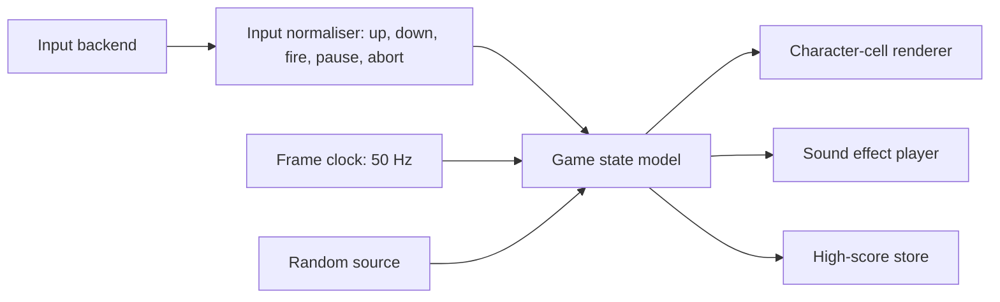

# Xargon's Revenge – Modification and Porting Guide

## What This Guide Provides

This guide is for anyone who wants to change Xargon's Revenge or rebuild it for another machine. It says what has to be preserved, translated or replaced, and it keeps the original game's behaviour separate from the architecture I'd suggest for new work.

Nothing described as a proposal here exists yet. There is no portable engine, no variant build target and no port in this repository. The only supported target is the historical C16 preservation build. Behaviour labelled **Observed** comes from the VICE runs and probes recorded in `docs/verification/`; everything else is read from the source in [Codebase Analysis](../CODEBASE_ANALYSIS.md).

---

## Choose the Intended Compatibility Contract

Decide first what kind of derivative you're making, because each kind needs different evidence that it's right.

| Kind of work             | Contract                                      |
| :----------------------- | :-------------------------------------------- |
| Same-platform derivative | 6502 on a C16/Plus 4; exact where untouched   |
| Emulator-hosted version  | Original PRG unchanged; new front end         |
| Native reimplementation  | Rules and timing reproduced in a new language |

A **same-platform derivative** keeps the TED, the raster bands and the character graphics, and can be checked byte for byte against the preservation build everywhere it hasn't been changed on purpose. An **emulator-hosted version**, such as a web page or handheld running the original PRG in an emulator, changes no game bytes at all; its work is input mapping, presentation and saving. A **native reimplementation** has to translate every hardware responsibility below, and can only be judged by traces and conformance tests.

---

## Protect the Preservation Build

The verified build is `build/xargons-revenge.prg`, SHA-256 `32c13c88…adce33`, and `make test` fails if a single byte changes. Keep it that way. Proposed workflow for any variant:

1. Leave `Original Source Recovered/` and `scripts/restore_c16.py` untouched.
2. Add a separate variant definition (for example `variants/<name>/`) holding replacement modules or patches keyed by module name and line number.
3. Give the variant its own output name and its own tests, and never let it overwrite `build/xargons-revenge.prg`.
4. Run the preservation tests on every change, so you know the original still builds.

This variant mechanism is a proposal. It isn't implemented, and none of the existing Make, PlatformIO or CI targets would build a variant today.

---

## Proposed Portable Architecture

A native port is easiest to keep faithful if the rules live in a pure state model and the hardware sits behind small interfaces.



A proposed state model, with the original variables it replaces:

| Portable field           | Original                                     |
| :----------------------- | :------------------------------------------- |
| `ship.row`, `ship.pixel` | `SHIPY` (0–13), `YPIX` (0–6, even)           |
| `laser`                  | `LASERS`, `LAZX`, `LAZY`, `FLOYD` row        |
| `aliens[16]`             | `ALIXPS`, `ALIYPS`, `ALIIND`, `ALSTAT` …     |
| `wave`                   | `SHEET`, `LEVEL`, `ATTAK`, `NUMALI` …        |
| `fuel`                   | `FUEL`, `FULINC`, `FUTEM`, `MPGVAL`          |
| `pod`                    | `FUELON`, `FUELX`, `FUELY`, `FULDIR` …       |
| `score`                  | `SCRBUF[8]`, `XTRA`, `LIVES`                 |
| `stars[16]`              | `STARXP`, `STARYP`, `STARSP`, `STSTOP`       |
| `scroll`                 | `TOPLX`, `BOTLX`, `TOPCNT`, `BOTCNT`, speeds |
| `mode`                   | Running loop, plus `TITLE`, `STOP`, `PAUSE`  |

The rows ending `…` also include `ALICOL` (aliens), `REGEN` and `ALIHIT` (wave) and `FUELTM` (pod).

Suggested backend interfaces, which don't exist yet:

- `Video.drawCells(band, cells, scrollX)` and `Video.setGlyph(bank, code, bytes)`, so runtime glyph rewriting stays explicit.
- `Audio.play(effect)` and `Audio.stop(voice)`, keyed by the five effect numbers.
- `Input.poll() → {up, down, fire, pause, resume, abort, joystickSelect, keyboardSelect, soundOn, soundOff}`.
- `Random.byte()`, with a seedable implementation for tests.
- `Store.loadHighScore()` and `Store.saveHighScore()`; the original keeps the high score only in RAM.

---

## Timing Domains

The original has two clocks, and a port must keep them apart.

| Domain     | Rate                    | Work                                         |
| :--------- | :---------------------- | :------------------------------------------- |
| Raster IRQ | 50 Hz (PAL), 5 bands    | Ship, stars, pod, laser, scroll, fuel, sound |
| Main loop  | At most 50 Hz, can drop | Aliens: draw each pass, step each `ALISPD`   |

The interrupt also reads the controls and redraws the score and fuel gauge. The ship, laser and fuel pod move once per frame, whatever the main loop is doing. The aliens move on main-loop passes that are synchronised to raster bit 8 by `RUSRAS`, so they slow down if a pass overruns a frame. A port that runs everything in one 50 Hz tick will be close, but not identical, when the original drops frames.

**Proposal:** run the IRQ-domain update every frame, and the alien update on frames where the original would have completed a pass. Treat the 60 Hz case as a choice: either fix logic at 50 Hz or scale the tempos (`ALISPD`, `MPGVAL`, `FUELTM`, effect lengths).

---

## Translate Coordinates Without Losing the Rules

Everything in Xargon's Revenge is measured in screen cells. Collisions are decided by reading back screen codes, not by geometry.

| Object   | Units                                       |
| :------- | :------------------------------------------ |
| Ship     | Column 1, window row `SHIPY` + pixel `YPIX` |
| Aliens   | Column 0–39, window row 0–14, 2 × 2 cells   |
| Laser    | One cell per frame, columns 5–38            |
| Stars    | X 0–158 in 2-pixel steps, window row 0–15   |
| Fuel pod | X in 2-pixel units, Y in pixels             |

**Proposal:** a port should keep a 40 × 25 cell map for the play window, even if it renders with sprites, and test collisions against it. Otherwise these rules change:

- The ship dies when any of its 12 cells holds a code from 186 to 220, and collects a pod from 179 to 185.
- An alien is hit when one of its 4 cells already holds code 63 (the laser) at the moment it is redrawn.
- Stars never overwrite anything but blanks and stars.
- Aliens wrap from column 0 to 39 and never test against each other.

---

## Graphics Composition

Use the decoded data in `docs/analysis/asset-data.json` rather than redrawing. [Illustrated Graphics](GRAPHICS.md) shows how each piece is assembled.

- **Ship:** rebuild the 3 × 4 cell block from `SHPDT1` at offset `YPIX`, or pre-render the four even offsets.
- **Aliens:** one 64-byte entry per sheet; frame 0 = codes 213–216, frame 1 = 217–220, laid out top-left, top-right, bottom-left, bottom-right.
- **Explosions:** random each wave (`CALEXP`). Reproduce the algorithm or capture representative frames, and say which.
- **Landscape:** keep the motif streaming (`TOPNEW`, `BOTNEW`) as structured data, plus the animated codes 87 and 91 and the TV picture.
- **Title:** decode `BANNER` and decide whether to copy the one-column shift `SCRLIT` produces.
- **Colours:** use `docs/verification/ted-palette.json`, measured from VICE, or another TED palette, and record which.

---

## Input Normalisation

Map host input to the original intents, not to physical keys:

| Intent              | Original key or bit      |
| :------------------ | :----------------------- |
| Up                  | S, or joystick up        |
| Down                | X, or joystick down      |
| Fire                | Return, or joystick fire |
| Pause               | SPACE                    |
| Resume              | G                        |
| Abort to title      | ESC                      |
| Joystick / keyboard | J / K on the title page  |
| Sound on / off      | S / Q on the title page  |

A new shot needs the fire input to change state (`OLDFIR`), so a held button fires once. The source reads both joystick ports and takes whichever is active.

---

## Rules That Need an Explicit Compatibility Choice

| Behaviour                       | Source (verified)        | Choice for a derivative          |
| :------------------------------ | :----------------------- | :------------------------------- |
| Alien graphics, sheets 5–16     | `BJH` as stored          | Source, or running-version shift |
| Starting lives                  | 5 (probe, both versions) | 5, or 3 as on the packaging      |
| Game length                     | 80 waves (probe)         | 80, or 96 as advertised          |
| Points per alien                | 50–350 by wave (static)  | Keep the table                   |
| Extra lives                     | Every 50,000 (probe)     | Keep                             |
| Score after completion replay   | `ATTAK` not reset        | Keep, or reset to 0              |
| Explosion shapes                | Random per wave          | Random, or fixed frames          |
| Title row placement             | Shifted one column       | Shifted, or as stored            |
| Reset key                       | ROM reset in VICE        | Ignore, or show the trap         |
| Score/pod race in the interrupt | Unprotected              | Serialise updates                |
| Frame rate                      | PAL 50 Hz                | 50 Hz, or scale tempos           |
| High score                      | RAM only                 | Volatile, or persist             |

Write the choice down in the variant and test it. "Source" is the default for anything that claims to be faithful to this repository.

---

## Hardware Responsibilities to Replace

| C16 feature               | Used for                                   |
| :------------------------ | :----------------------------------------- |
| TED raster interrupt      | Five display bands and all per-frame work  |
| TED character banks       | `$1000` landscape, `$3800` font and actors |
| Multicolour attributes    | Ship, pod, land; hires aliens and stars    |
| Fine X scroll, 38 columns | Roof, ground and message                   |
| TED voices 1 and 2        | Five effects, noise and square tones       |
| TED timers `$FF00–$FF02`  | Random numbers and explosion masks         |
| Keyboard matrix `$FD30`   | Keys through `KEYIT`                       |
| Joystick latch `$FF08`    | Both ports                                 |
| ROM banking `$FF3E/$FF3F` | Vectors in RAM; reset trap                 |

---

## Target Families and Likely Work

| Target                         | Likely approach                              |
| :----------------------------- | :------------------------------------------- |
| C64                            | Same 6502 logic; VIC-II bands, SID sound     |
| Plus/4 enhanced                | Same-platform derivative; more RAM, same TED |
| Modern PC or web               | Native model, 50 Hz clock, cell renderer     |
| Microcontroller with a display | Native model; cell renderer suits small TFTs |
| Emulator front end             | Original PRG in VICE or a web TED emulator   |

These are suggestions. None has been started.

---

## Suggested Development Milestones

1. **Data:** load `asset-data.json`, render the ship, one alien and one landscape motif, and compare them with the [graphics figures](GRAPHICS.md).
2. **First playable slice:** one wave on sheet 1, with ship movement, laser, 16 aliens on `PATD1`, hits, explosions and `NUMALI` completion, with no fuel, sound or title.
3. **Wave flow:** `SETSHT` difficulty, all 16 patterns, respawning, `COMPLE` and the fuel bonus.
4. **Resources:** fuel drain, pods, gauge, death and lives.
5. **Presentation:** scrolling landscape, stars, message, title banner and sound.
6. **Completion:** planets, the 80-wave ending, game over and high score.

---

## Trace and Fixture Formats

**Proposal:** record traces from the original in VICE and replay them against the port. A trace line per main-loop pass could be JSON:

```json
{"pass": 120, "frame": 245, "input": {"up": false, "down": true, "fire": true},
 "ship": [7, 4], "laser": [12, 9], "aliens": [[30, 3, 0, 4], [22, 8, 135, 2]],
 "score": "00000050", "fuel": 104, "lives": 5, "sheet": 0, "level": 0}
```

Fixtures should pin the random source. The original seeds `RND` from TED timers in `SETSHT`, so a trace must record the seed bytes, or the port must accept injected `RND` values. The existing probe harness (`scripts/probe_gameplay_rules.py`) shows how to set memory, call one routine from a workspace caller at `$0BE8` and save the result.

---

## Conformance and Regression Test Plan

| Test                       | Evidence to match                     |
| :------------------------- | :------------------------------------ |
| Score and extra lives      | `score-*` probes                      |
| Wave and level progression | `wave-completion` probes              |
| Alien glyph selection      | `alien-characters-per-sheet` probe    |
| Start-of-game state        | `vice-verification.json` (lives 5)    |
| Graphics decoding          | `graphics-manifest.json` pixel checks |
| Title layout               | Banner simulation in the manifest     |
| Movement and collisions    | Future VICE traces (not yet recorded) |
| Sound                      | Future recordings (not yet made)      |

Run the preservation tests (`make test`) alongside any port's tests, so the reference stays trustworthy.

---

## Open Work Before a Complete Port

- Record movement and collision traces from VICE for at least the first wave.
- Confirm the points per alien by playing, not only from the table.
- Record the five sound effects and the fuel-bonus tone.
- Test the original on real hardware, especially timing and the reset trap.
- Decide each row of the compatibility table and document the choice.
