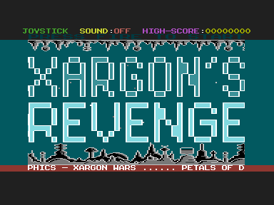
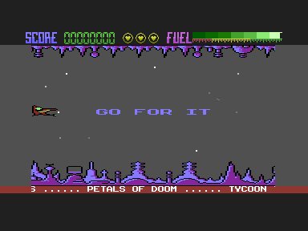
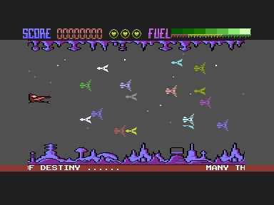

# Source and Validation

## Result – 21 October 2026

The reassembled code matches the original object listing exactly, and the running version I have contains the same code. The build produces two playable versions that differ only in their alien graphics: game v1 (development) and game v2 (cassette release). Game v2 matches the decompressed running version in every byte of the aliens, landscape, code and font; [Game Versions](GAME_VERSIONS.md) explains both.

| Check                                | Result                    |
| :----------------------------------- | :------------------------ |
| `OBJ` bytes compared (`$1800–$379D`) | 8,094, all identical      |
| Running version's code vs `OBJ`      | 8,094, all identical      |
| Landscape `$1000–$17FF` vs running   | Identical (`LANDSCAPE-2`) |
| Font `$3800–$3FFF` vs running        | Identical (`FRAK!`)       |
| Aliens: game v1 vs running           | 735 bytes differ (loader) |
| Aliens: game v2 vs running           | Identical                 |
| Title in VICE                        | Drawn                     |
| Gameplay in VICE                     | Reached and kept running  |
| Entry points                         | Identical PRG bytes       |

Each PRG is 15,362 bytes, loads at `$0400` and starts at `$1800`. Game v1 has SHA-256 `32c13c8867ea97bb4fd60ac9a73e5d7a600c04ece5699ac37680143c12adce33` and game v2 `0ee0a82306583c8bf4a17f44731eaeb411f098ba9c00d20885b26879cd397665`. The evidence is in [`build-comparison.json`](verification/build-comparison.json), [`vice-verification.json`](verification/vice-verification.json) and [`rule-probes.json`](verification/rule-probes.json).

  

---

## Source Selection and Assembly

The source disk `Xargon's Revenge.d64` (first 2026 copy) is read directly by `scripts/d64_image.py`. All 94 live files are compared byte for byte with the 2026 extraction and its `manifest.json`, and the image hash must match the manifest's `source_sha256`. The partial copy of the 5 Lives disk, with the loading screen, is checked the same way.

`REVENGE` includes 67 modules through `.LIB`, so the main program is built from 68. 62 come from the 2026 disk and six from the 1992 export, chosen through its `INDEX` because they aren't on the 2026 disk: `ALI-PRINT&CLEAR`, `COMPLETED-SHEET`, `DATA-LAND/CHARS`, `FIRING-MEGA/CODE`, `RASTER-ROUTINES` and `WHOOPPEE-MESSAGE`. The 2026 disk has exactly 36 more free blocks than the 1992 directory listing, which is the combined size of those six files. The image is a CBMXfer rebuild that drops 15- and 16-character names; a later `d64copy` sector copy of the same disk holds all six, identical to the 1992 text ([Development Disks](DEVELOPMENT_DISKS.md#what-the-copying-tools-did)).

Every module present in both collections agrees after normalising the 1992 export's lower case and CRLF line endings, except one character in a comment of `CHAR#1-BOT`: the 2026 disk has PETSCII `$AF` where the 1992 export has a space. That comment isn't assembled.

`scripts/source_converter.py` translates the original assembler's syntax for ca65 without changing any instruction: labels get a colon, `*=` becomes a segment and `.org`, `*=*+n` becomes `.res`, and single-quoted strings become double-quoted. The build fails on a missing, ambiguous or recursive `.LIB` include, and on any macro definition, since this source has none.

### Memory Layout

| Region        | Source                                       |
| :------------ | :------------------------------------------- |
| `$0002–$00FD` | `VARS` (reserved, zero page)                 |
| `$0200–$02BF` | `EXTRA-MEMORY` (reserved)                    |
| `$0400–$07FF` | `BJH`, loaded and copied by the dev `LOADER` |
| `$0800–$0FFF` | Zero padding (colour and screen RAM)         |
| `$1000–$17FF` | `LANDSCAPE-2`                                |
| `$1800–$379D` | Assembled `REVENGE`                          |
| `$379E–$37FF` | Zero padding                                 |
| `$3800–$3FFF` | `FRAK!`                                      |

This is the arrangement my own boot program creates. `C16` programs the F1 key to load `MEGA-SUPER` and use it to read the `OBJ` hex file, then load `FRAK!`, `LANDSCAPE-2` and `LOADER`, which loads `BJH`, copies it to `$0400` and jumps to `$1800`. The rebuild puts the same bytes in the same places as one PRG.

---

## Graphics Provenance

| Asset         | Choice and reason                          |
| :------------ | :----------------------------------------- |
| `BJH` aliens  | Named by `LOADER`; first 1 KB of `ALIBUM8` |
| `LANDSCAPE-2` | Named by `C16`; equals the running version |
| `FRAK!`       | Named by `C16`; equals the running version |

The landscape also exists as source. `ASSEM-GRAPHS` assembles `CHAR#1-BOT` at `$1000` and `CHAR#1-TOP` at `$1600`; the result differs from `LANDSCAPE-2` in 29 bytes and from the older `LANDSCAPE-1` in 7, so the source is an earlier revision. The build assembles it for comparison only. `O.ALI` is a hex listing equal to the first 1 KB of `ALIBUM5`, an earlier alien set. `ALIBUM5` to `ALIBUM8` are kept as alternatives and aren't used.

---

## Comparison with the Running Version

`xargons_revenge.prg` is a compressed program: a BASIC line `SYS 4109` and a decompressor at `$100D`. Its origin is unknown; I downloaded it. Instead of comparing two different file formats, `scripts/verify_vice.py` lets it decompress in VICE, stops at `$1800` before the first game instruction, and saves `$0400–$3FFF`.

| Region        | Bytes differing | Classification                    |
| :------------ | :-------------- | :-------------------------------- |
| `$0400–$07FF` | 735             | Alien graphics (loader effect)    |
| `$0800–$0FFF` | 1,859           | Colour/screen RAM: loader residue |
| `$1000–$17FF` | 0               | Landscape graphics                |
| `$1800–$379D` | 0               | Initialized code and data         |
| `$379E–$37FF` | 87              | Padding: assembler symbol text    |
| `$3800–$3FFF` | 0               | Font graphics                     |

The alien difference has a clear mechanism. A tape loader is still sitting in the running version's memory at `$0C00`; it loads files `P1` to `P4` from device 1 and copies four pages to `$0400`. Its copy loop increments the low byte of the source address instead of the high byte, so page *p* at `$0400 + p × 256` receives `BJH` from offset *p*, and sheets 5–16 reuse the sheet 1–4 designs. The verification confirms that page 0 equals `BJH` and pages 1, 2 and 3 equal `BJH` from offsets 1, 2 and 3. The loader on the second 2026 disk has the same structure for device 8, and its loop increments the high bytes correctly.

**Effect in play:** the `alien-characters-per-sheet` probe runs the original `ALIDEF` for all 16 sheets in both versions. Sheets 1–4 produce identical glyphs and sheets 5–16 differ. [Illustrated Graphics](GRAPHICS.md#aliens) shows both sets.

Both layouts are built. Game v1 keeps the source layout, because that is what my own boot program produced. Game v2 applies the tape loader's rule to `BJH` from the source disk; `scripts/verify_vice.py` then confirms it equals the decompressed running version outside the loader residue and padding.

---

## Rule Probes

`scripts/probe_gameplay_rules.py` calls original routines in VICE with controlled memory from a short caller at `$0BE8`, which `EXTRA-MEMORY` lists as free. No game instruction is changed.

| Probe                       | Result                                 |
| :-------------------------- | :------------------------------------- |
| Score 49,999 + 1            | 50,000 and one extra life              |
| Score 50,000 + 1 (again)    | No extra life                          |
| Score 99,999 + 1            | 100,000 and one extra life             |
| Score 149,999 + 1           | 150,000 and one extra life             |
| `ALIDEF`, sheets 0–15       | Same for 0–3, different for 4–15       |
| `COMPLE`, waves 1, 16, 64   | Next wave                              |
| `COMPLE`, wave 80           | Completion screen (`ENDLVL`)           |
| Soft and hard reset in play | Resume in ROM at `$F2A4`, not the trap |

These are controlled observations of single routines. They aren't evidence of full gameplay, timing, collisions or sound.

---

## Emulator Evidence and Limits

The VICE runs use `xplus4` 3.10 as a PAL C16 with 16 KB, sound off, warp mode, rendering filter off and a fixed cycle limit. Input is scripted: the run waits for the title's fire test (`TITTER`) to pass 36 times, sets `JFIRE` to `$80` there, clears it at the first main-loop pass and then supplies no input. No instruction is patched.

The screenshots are byte-for-byte reproducible between runs. The gameplay checks confirm `TITLE=0`, `LIVES=5`, `DEAD=0`, `SHEET=0` and `LEVEL=0` at entry. After 256 more passes with no input `LIVES` had fallen to 3 and the game was still playing, in both versions.

Still to do: testing the keyboard and a joystick by hand, listening to the sound, playing a whole wave, playing to the end, and running on real C16 or Plus/4 hardware. [Testing](../TESTING.md) lists how to run each check.

---

## Recovery Background

How the 1985 disks were recovered is told in the [Dorks Dilemma C16 repository](https://github.com/anthonyjclarke/Dorks_Dilemma_C16) and its [Development History](https://github.com/anthonyjclarke/Dorks_Dilemma_C16/blob/main/docs/DEVELOPMENT_HISTORY.md). [Source Inventory](SOURCE_INVENTORY.md) lists this game's inputs.
